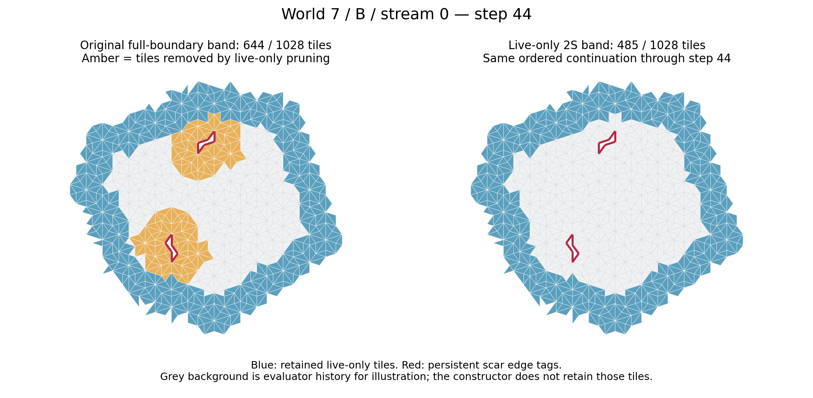

# Test 1: amber-lobe / live-frontier-only retention

**The large scar-retained lobes were not necessary for the tested finite continuation or for the primary grid's zero-A result.** All eleven correlated B-jam cases reproduce the audited full-patch continuation through step 44 using live-only retention at **each of 1S, 2S and 3S**. The primary 2S bands also retain zero A selections in the fixed 528-window grid under both numerical conventions. This is an executed result, not a proposed experiment.

There is a real qualification: deleting a scar's neighbourhood can change the answer to a subsequent *legality query at that dormant edge*. Construction still agrees because the unchanged scheduler permanently skips pinned edges. Continuing construction and re-evaluating a dormant scar require different information.

## Primary 2S retention

Rows group cases only to avoid repeating identical counts; they do not assert independent trials or geometric equivalence.

| Cases (B, stream index) | Jam step | Jam band: original → live | Step-44 full patch | Step-44 band: original → live | Retained fraction: original → live |
|---|---:|---:|---:|---:|---:|
| w7-s0, w7-s1 | 23 | 315 → 308 | 1,028 | **644 → 485** | **62.65% → 47.18%** |
| w5-s0, w21-s0, w21-s1 | 42 | 450 → 444 | 959 | 492 → 479 | 51.30% → 49.95% |
| w15-s0, w19-s0, w28-s0 | 39 | 551 → 544 | 1,037 | 597 → 552 | 57.57% → 53.23% |
| w19-s1, w28-s1, w29-s1 | 43 | 582 → 576 | 1,298 | 608 → 594 | 46.84% → 45.76% |

At **post-step 23**, the two w7 cases retain **313/439 = 71.30%**, versus the original **327/439 = 74.49%**. The other nine cases have not yet reached their intervention checkpoint at step 23; their original band counts are 272 (w5/w21), 434 (w15/w19-s0/w28-s0) or 463 (w19-s1/w28-s1/w29-s1), and the experimental step-23 value is marked not applicable. “Jam” in the table means before the first scar batch, so its denominator differs from post-step23.

The largest saving is w7: **159 fewer retained tiles**, or **24.69% of the original band**. The full-patch denominator is unchanged. Across cases, the primary final retained fraction is 45.76–53.23%, compared with the original 46.84–62.65%.

## Construction and radius controls

| Live-only radius | Exact completions / cases | Final band counts in the four table groups above | Reader scan performed? |
|---|---:|---|---|
| 1S | 11/11 | 355; 356; 405; 440 | No — continuation control only |
| **2S (primary)** | **11/11** | **485; 479; 552; 594** | **Yes, 528 windows** |
| 3S | 11/11 | 591; 581; 682; 725 | No — continuation control only |

All 231 post-jam worker steps across 33 trials make positive progress. Ordered live candidate menus (decorated keys), forced/free outcomes, raw ordered placements, frontier identities/order, PRNG before/after and normalized post-step scar sets agree with the audited baseline. Full-history validation and endpoint complete/partial decorated-star and independent triangle-overlap checks pass. No restoration continuation was triggered. **1S is the smallest radius tested, not a proven minimum.**

## Fixed-grid readout

Each row counts all 528 requested windows, including both jam and final endpoints. There were no empty selections, reconstruction failures or unavailable endpoints.

| Band / convention | B-only | Ambiguous | Empty/incompatible | A-only |
|---|---:|---:|---:|---:|
| Original full band / open | 111 | 64 | 353 | **0** |
| **Live-only 2S / open** | **131** | **67** | **330** | **0** |
| Original full band / closed | 86 | 94 | 348 | **0** |
| **Live-only 2S / closed** | **89** | **115** | **324** | **0** |

The original native-rule reproduction gate passed exactly. Open means the frozen reader's positive-area decision thresholds; closed means the referee check's numerical LP feasibility convention, including point/segment contacts. These are not symbolic proofs of strict `r>0` or closed `r>=0` inequalities.

The open jam tally remains 49 B / 37 ambiguous / 178 empty. At the final checkpoint it changes from 62 B / 27 ambiguous / 175 empty to 82 B / 30 ambiguous / 152 empty. Under closed scoring, the final B count remains 52; its ambiguous/empty split changes. Band centroids and selected connected components change when tiles are deleted, so the aggregate increase in open B decisions is **not** a matched-subset information gain or evidence of continuous memory transport. No 1S/3S readout or expanded scan was run.

## Dormant-scar monitoring and the small local witness

For primary 2S, the first monitoring mismatch is **w7, step 35**, in both streams. A band-only query at an old pinned edge now admits candidates, while the full-history evaluator still rejects them. The constructor never reattempts that edge and its trajectory remains exact. All other primary cases' sampled scar queries agree through 44.

For the first differing w7 query, restoring **one deleted neighbouring tile** recovers the original empty candidate menu. Its missing corner information at **one vertex alone** also suffices in a diagnostic copy, without adding occupancy tiles. Zero added context fails, and the single-tile removal check fails, so the one-tile witness is minimal in count **for that one query**. It is not a globally minimal summary for every dormant edge or future horizon. No such summary or restored tile was supplied to any scientific constructor.

The first monitoring mismatch moves to step 26 at 1S and step 37 at 3S in w7. At 1S, the w15/w19-s0/w28-s0 group also develops a first mismatch at step 42. The first-query witnesses and vertex summaries are recorded separately in `results/query_diagnostics.json`.

## Exact claim and limits

> On these eleven recorded correlated B-jam cases, removing pinned-scar edges as retention centres, while retaining their oriented boundary tags and permanent skip status, preserves the audited full-patch continuation through step 44 at the three tested radii. At the primary 2S radius, the resulting bands also preserve zero A-only selections in the specified 528-window endpoint grid under both stated numerical conventions. Large scar-retained tile lobes are therefore not necessary for those finite tested outcomes; they can still contain context needed to recompute dormant-edge legality.

This constructor still retains **true-frontier metadata**, not just tiles. Owner-tile references are removed, but oriented edge records retain p/q/r coordinates. In w7 at step44, 20 metadata coordinates lie outside the retained tiles. This is disclosed boundary information, not a claim that every coordinate of deleted material has vanished. The endpoints remain guarded, so deletion-created cavity edges never become construction frontier.

The initial zero-candidate reconnaissance is moved before initial thinning/serialization, without placement or RNG use; subsequent scheduler pinning is unchanged. This prevents a known dead site from being revived merely by deleting its context. The experiments start at their pre-scar checkpoints, not at the original seed. No indefinite-growth, universally reliable reader, statistical-independence or continuous-memory claim follows.

Protocol was committed before outcomes (`62cd04b`). Base `41a9952edfbe350abfd9e2807e6cb6871d9f4881`; frozen engine/reader `84130b97f5044197392e72cd53e0e71f81b043f3`. Branch: `experiment/amber-lobe-ablation-2026-11-06`. See `README.md` for reproduction and provenance. All changes are in this experiment directory; scar/referee files remain unchanged. No merge or force-push.

