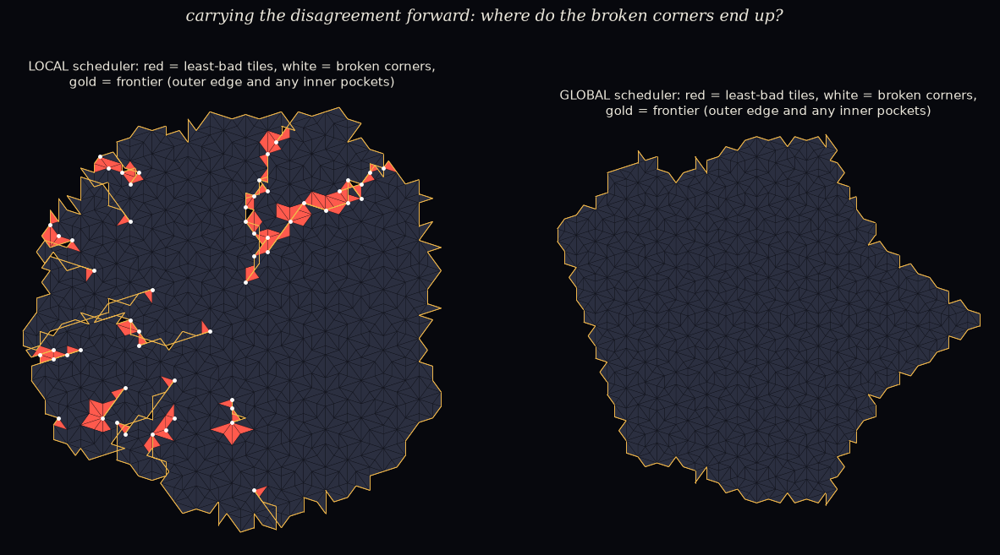

# Carry the disagreement forward: what if a world never jams?

*A pre-registered study, from Katie's doozy "a real universe never jams; it carries the disagreement
forward" (2026-10-20). It tests the campfire gods #5 (allow mistakes; do they heal?) and #6 (are the
unhealed mistakes the stuff?). The pre-registration was committed before any code:
[`PREREGISTRATION.md`](PREREGISTRATION.md).*

*Run note: the first run crashed within seconds, before producing any results. The defect counter
tripped on empty corner entries. That was fixed (a separate commit) and the run repeated with
unchanged rules.*

**The set-up.**

- The impatient local-now scheduler of `local_nows/` (R = 3), which jammed all 24 worlds, on the same
  24 seeds.
- One change: wherever no legal tile fits, the world places a **least-bad** tile instead of jamming.
  That is a tile that fits geometrically and breaks the fewest corners.
- A **broken corner (defect)** is a vertex whose tiles don't form a legal Penrose arrangement.
- The GLOBAL scheduler with the same rule is shown for comparison.

## Scorecard

| | prediction | result | |
|---|---|---|---|
| M1 | no more jams: ≥ 20/24 reach 1500 tiles | **24 / 24** | ✅ HELD |
| M2 | the disagreement is carried: broken corners still on the frontier at the end (≥ 50%) | **24 / 24** | ✅ HELD |
| M3 | the scars are lines: whole defect set elongated ≥ 3 (≥ 50%) | **2 / 22** (median ~1.8) | ❌ FAILED |

**Reported.**

- **LOCAL:**
  - a median of **57 least-bad tiles** per world, about **3.7%** of all tiles;
  - a median of 32 broken corners, 30 of them still on the frontier at the end;
  - frontier defects grow over the run: 0 → 11 → 30 (medians at ⅓, ⅔, end).
- **GLOBAL** needed the rule in only 2/24 worlds, with almost no defects.

*One world (seed 0). Left: LOCAL. Red = least-bad tiles, white = broken corners, gold = frontier.
Right: GLOBAL, from the same seed: clean. ([`figure_EXPLORATORY.py`](figure_EXPLORATORY.py))*

## What the picture shows

- **The world grows around its broken corners.** It can never legally close the space next to a
  broken corner, so it leaves **cracks**: thin open fissures, and a few inner pockets.
- In this world, 36 of 55 broken corners sit on the outer boundary (mostly inside cracks open to the
  outside), and 19 sit around three inner pockets.

**Cracks measured one by one** (exploratory, after the fact, because M3 failed on the whole set;
[`cracks_EXPLORATORY.py`](cracks_EXPLORATORY.py)):

- 60 cracks with ≥ 5 broken corners across the 24 worlds (0–6 per world).
- Mostly short: median length 3.5 edges, longest 12.6. Elongation median 2.5; 18/60 are ≥ 3.
- **46 of 60 reach the growing rim.** Most broken corners are fairly recent and near the edge.
- A minority are left behind in the interior.

## What it means (plainly)

- **A world that never jams keeps growing**, at a modest cost: about 1 tile in 27 is a compromise.
- **The disagreements are carried forward, and the world grows around them.** Broken corners can't be
  repaired, so they leave open cracks and pockets. These are places the world can't close: literal
  gaps in the fabric.
- **But they are mostly not long travelling lines** (M3 failed; cracks are mostly short). Most sit at
  the growing edge, where impatient local nows keep making new disagreements. A minority are left
  behind in the interior, which is "healing" in the only sense possible here: they stop growing.
- **God #6 (the scars are the stuff), not yet.** We see scars that persist, but not yet a scar that
  keeps its identity while being re-made slice after slice. Telling those apart needs **tracking
  individual cracks over time**:
  - does a crack's mouth stay at the rim and lengthen with the front (one thing, re-made), or
  - do new cracks keep appearing while old ones freeze (many short-lived things)?

## Limits

- **The repair rule shapes the outcome.** Once a corner is broken, no legal tile can ever go next to
  it, so more least-bad tiles cluster there. Some of the "carrying" may be the rule feeding itself.
- **"On the frontier" includes the walls of open cracks**, not just the outer edge.
- Crack grouping (1.5-edge linkage) and the "reaches the rim" test are rough and after the fact.
- Same 24 seeds as `local_nows/`; one repair rule; one scheduler radius.

## Files

- `carry_forward.py`: the study (`results/carry_forward_report.txt`, `results/worlds.json`,
  `results/run.log`). Its `keep=True` option is used only by the exploratory scripts.
- `figure_EXPLORATORY.py`, `cracks_EXPLORATORY.py`: the picture and the per-crack measures.
