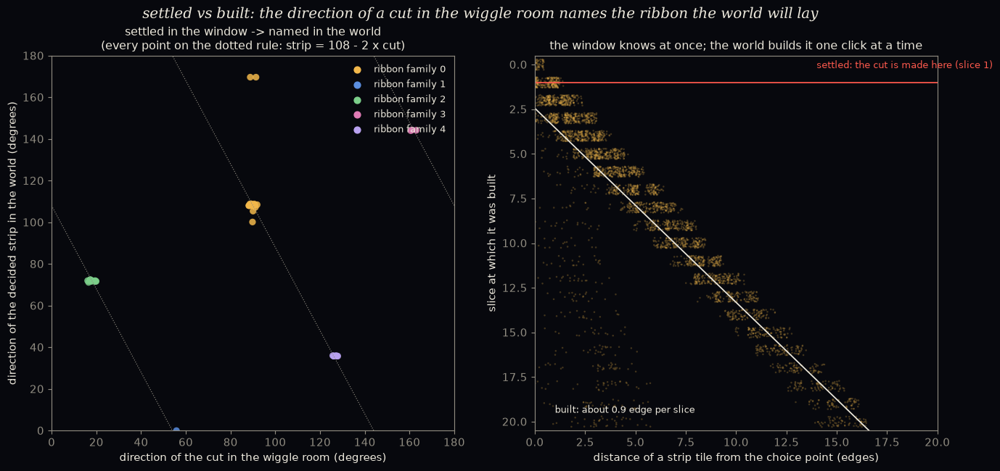

# Settled in the window, built in the world: the cut's direction names the ribbon

*A pre-registered study. The pre-registration was committed before any code:
[`PREREGISTRATION.md`](PREREGISTRATION.md). It grew out of Katie and Argon's Ammann-bar picture, and
Katie's rule that nothing outruns the now.*

**Why.** A two-way choice cuts the wiggle room F along one straight line. In the world, a choice
decides mostly one ribbon lying along the now. Are these the same event seen from two sides? If so, the
window *settles* which ribbon will be laid before the world has *built* it.

**The set-up.**

- 24 fresh worlds gave 67 live two-way choices, which are 45 distinct situations.
- For each choice:
  - the cut line between the two options' pieces of F, read right after the choice;
  - both futures grown 20 slices;
  - the **decided strip**: tiles one future has where the other has a different tile.
- The lookup table "cut direction → ribbon family" was learned on worlds 0–11 and tested on 12–23.

## Scorecard

| | prediction | result | |
|---|---|---|---|
| C1 | each choice decides mainly **one** ribbon family (top family beats the next by ≥ 0.15, in ≥ 70%) | **44 / 45**; top share ~0.67 (baseline ~0.4) | ✅ HELD |
| C2 | the cut's direction predicts the family in held-out worlds (≥ 80%; chance ~20%) | **17 / 17** | ✅ HELD |
| C3 | the learned table is one-to-one | 4 directions → 4 different families | ✅ HELD |
| C4 | the strip runs perpendicular to its family's edges (within 20°, in ≥ 70% of elongated strips) | **41 / 41**, all within 3° | ✅ HELD |

> **A binning mistake, reported openly.**
>
> - I registered cut directions as "rounded to the nearest multiple of 36°". The real cut lines sit at
>   **18°, 54°, 90°, 126° and 162°** (18° + multiples of 36°).
> - So my bins merged 126° and 162° into one bin, "144°". That is why training saw that bin split
>   between two families (5 and 3).
> - The registered results still stand as computed. C2's test cases happened to fall in unmixed bins.
> - With the correct bins ([`figure_EXPLORATORY.py`](figure_EXPLORATORY.py),
>   [`results/corrected_EXPLORATORY.txt`](results/corrected_EXPLORATORY.txt)):
>   - all **five** directions appear;
>   - each names exactly **one** family, all five families are used, and that holds in **45 / 45**
>     situations.

*Left: every situation's cut direction in the window against its decided strip's direction in the
world, coloured by ribbon family. All the elongated strips sit on one rule (dotted). Right: settled vs
built. The cut is made at once, at the choice. Each strip tile gets built at a slice proportional to
its distance from the choice point.*

## What it means (plainly)

- **The window's cut names the ribbon.** Each of the five possible cut directions in the wiggle room
  goes with exactly one of the five ribbon families: family *j* ↔ cut line at 90° − 36°·*j*.
  - The decided strip then runs along that ribbon, perpendicular to its edges.
  - In physical directions, for every elongated strip (within 2.6°):
    **strip direction = 108° − 2 × cut direction**.
  - The factor of −2 is a strong hint for a derivation. The map between the world and the window
    (the "star map") doubles angles: physical edge direction *j* ↦ window direction 2*j*. *(A hint,
    not yet a proof.)*
- **Settled at once, built one click at a time.**
  - The moment the choice is made, the cut in the window fixes which ribbon will be laid, and in which
    direction.
  - In the world, strip tiles get built at about **0.9 edges per slice** outward from the choice
    point: slice ≈ 2.4 + 1.1 × distance.
  - That matches the speed limit measured in `speed_of_light/` (about 0.95 edges per round along the
    now).
  - So nothing outruns the front, as Katie insisted. What's *determined* and what's *built* are
    different, and they travel at different speeds.
- **This connects Argon's Ammann-bar picture to our data,** with Katie's correction built in. The
  "string" is laid one click per slice, inside the world, along the now.

## The derivation

[`DERIVATION.md`](DERIVATION.md) sketches why the rule holds: ribbons run across their edges,
the lift-to-window map doubles angles, the window's facets face only five directions, and a choice
about a family-*j* ribbon cuts along that family's window direction. The last step is observed in
45/45 situations and argued from de Bruijn's picture, but not yet proven. Numerical checks:
[`derivation_check_EXPLORATORY.py`](derivation_check_EXPLORATORY.py).

## Limits

- 45 distinct situations; the 54° and 162° directions are rare (1 and 3 situations).
- Lookup table learned, not derived; the −2 rule is a strong hint, not a proof.
- 20-slice window; strips still growing were measured as they stood.
- Four strips were not elongated, and two of those sit 62° off the rule. Their "axis" isn't
  meaningful.
- "Built at slice s" uses each future's own growth. The settledness is shown through the cut, not by
  checking every possible completion.

## Files

- `cut_direction.py`: the study. Writes `results/cut_direction_report.txt`, `results/worlds.json`,
  `results/run.log`.
- `figure_EXPLORATORY.py`: corrected binning, the rule, and the figure. Writes
  `results/corrected_EXPLORATORY.txt` and `figures/cut_direction.png`.
