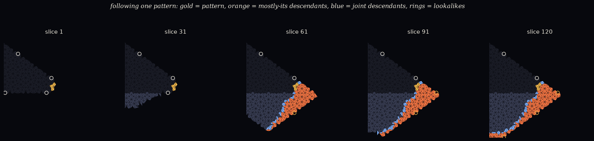

# Following one pattern on the front (exploratory)

*Astra's suggested first step (2026-10-15), before any registered study: can we follow one thing
through new construction without accidentally swapping it for a lookalike? No predictions. The
selection and lineage rules were written into
[`follow_EXPLORATORY.py`](follow_EXPLORATORY.py) and committed before each run.*

## The rules

- **World:** a fresh ordinary seed, grown with the patient scheduler to 600 added tiles.
- **The pattern:** the tiles meeting at one frontier vertex, the one whose direction from the seed
  centre is closest to 0°. This is chosen by geometry, not by its future.
- **Forcing dependencies:** a tile's legality is checked at its three corners, against the tiles
  already there. So its **parents** are all the tiles sharing a corner with it when it's placed: a
  joint set, with no fictitious single parent.
- **Lineage:** a new tile is a **descendant** if any parent is the pattern or a descendant.
  - Its **strength** is the share of its parents that are in the lineage. 1 means it was built only
    from the lineage; low means it was built jointly with outsiders.
- **Lookalikes:** other frontier vertices with the same partial shape, inside or outside the lineage.
- **Labels per slice:**
  - **ACTIVE:** new descendants this slice;
  - **PAUSED:** none, while growth happens elsewhere;
  - **ENDED:** the run is over.

## What happened

**Run A** (any frontier vertex; 40 slices;
[`results/follow_EXPLORATORY.txt`](results/follow_EXPLORATORY.txt)):

- The rule picked a vertex where only **one** tile met, a single protruding corner.
- It was **PAUSED for 37 slices** while the front grew elsewhere. Then it had a few descendants,
  built mostly *jointly* with outsiders (strength ~0.2–0.6).
- Lesson: a pattern can sit idle for a long time. A pause is not a death.

**Run B** (≥ 3 tiles at the vertex; 120 slices; rule added after A and fixed before running;
[`results/follow_EXPLORATORY_B.txt`](results/follow_EXPLORATORY_B.txt),
[`figures/follow_B.gif`](figures/follow_B.gif)):

*Gold: the pattern (6 tiles at one corner). Orange: descendants built mostly from the lineage. Blue:
descendants built jointly with outsiders. Dark: settled before. Grey: new and unrelated. Rings:
lookalike vertices (white outside the lineage, gold inside).*

- **Paused for the first 35 slices**, then ACTIVE in 60 of the 120 slices, in bursts.
- **The lineage grew into a region, not a travelling knot.** By slice 120 it had 357 descendants, and
  71% of them were built *only* from the lineage.
  - It spreads as a widening **sector** of the world, outward and along the front, away from the
    original corner.
  - Each slice, the newest descendants form a fairly compact group (median spread ~2.5 edges). That
    group drifts along the front, ending ~28 edges from the pattern.
  - But this is the place where the front is currently working, not a compact object that keeps its
    shape.
- **A seam.** Where the lineage meets unrelated growth, there is a thin line of *jointly built*
  (blue) tiles. Lineages behave like **domains with boundaries**.
- **Lookalikes everywhere.** Vertices with the pattern's exact shape appear outside the lineage
  throughout (5–7 at a time). Some also appear inside the lineage later (up to 4). Resemblance alone
  would have mixed up descendants with unrelated copies.

## Astra's question, answered for this one example

*Does this pattern have a localized continuation through new construction, or does its influence
spread out while similar shapes recur independently?*

**Its influence spreads out, into a growing domain.** Similar shapes recur independently, both
outside and inside it. What stays compact is only the *active edge* of the domain, the part of the
front being built right now. Nothing here looks like a recognisable thing that keeps its shape while
it moves. Possible readings:

- under these rules, a compact "piece of stuff" needs a different definition (perhaps a domain and
  its boundary seam, or the active tip); or
- it isn't produced at all.

**This is one example**, and no general claim is made. It is a picture to decide what to measure.

## Possible next steps

- Run the same rules on several worlds and patterns, to see whether "growing domain + seam" is
  typical.
- Track the **seam**: Astra's list included "persistent boundaries" as a possibility. A boundary
  between two lineages might be the more persistent kind of thing.
- Astra's step 2, the **two-choice compatibility table** (cuts at a distance), doesn't need any of
  this identity machinery, and can go ahead independently.
