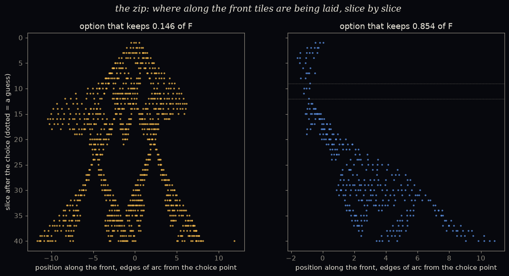

# More of the zip, or a faster zip?

*A pre-registered study (Astra's suggested next test after [`../speed_of_now/`](../speed_of_now/)). The
pre-registration was committed before any code: [`PREREGISTRATION.md`](PREREGISTRATION.md).*

**Why.** At a two-way choice, the option that keeps the smaller piece of the wiggle room F unlocks far
more forced growth. Astra asked *what kind* of more:

- is more of the front active ("more of the zip running"), or
- does each active part advance faster ("the zip running faster")?

And once both futures have finished their first bursts, do they even out?

**The set-up.**

- 24 fresh worlds gave 45 live two-way choices with unequal pieces (8 exact 50/50 splits and 2 dead
  options were set aside). Those 45 choices are **28 distinct situations**: patches identical relative
  to the choice point count once.
- Both futures of each situation grew in lockstep until both first bursts had ended plus 20 slices,
  with a cap of 100.
- Each slice recorded:
  - the **active boundary**: the length of front that received a tile;
  - the **tiles per active length**;
  - how far outward the new tiles sat from the old patch.

## Scorecard

| | prediction | result | |
|---|---|---|---|
| A1 | more of the zip: the smaller-piece future has the longer active boundary (≥ 70%) | **28 / 28** (and 45/45 per choice); from barely longer (1.02×) to 5× longer, median about 2.2× | ✅ HELD |
| A2 | same density: tiles per active length within 0.8–1.25 (≥ 70%) | **28 / 28**; ~0.71–0.75 in both futures | ✅ HELD |
| A3 | same outward advance: ratio within 0.8–1.25 (≥ 60%) | **2 / 28**; the decided future moves outward *slower* (~0.15 vs ~0.25 edges per slice) | ❌ FAILED |
| A4 | evens out afterwards: active-share ratio within 0.8–1.25 (≥ 60% of pairs that get there) | **6 / 20**; median ratio 0.76 (11 below 0.8, 3 above 1.25); 8 pairs never got a full window | ❌ FAILED |

**Reported.**

- With the 40-slice cap gone, the smaller-piece future had the bigger burst in **28 / 28** situations.
  Bursts reached up to 2,691 tiles, and three never ended within 100 slices.
- The "smaller piece" measured right after the choice agreed with the one measured at burst end in
  28/28.

## The picture: the zip

*Where along the front tiles are laid, slice by slice, for one choice. Left: the option that keeps
0.146 of F opens a **two-sided cone** from the choice point. Right: the option that keeps 0.854 sends a
**single thin thread** off to one side, and pauses twice to guess (dotted lines).
([`zip_EXPLORATORY.py`](zip_EXPLORATORY.py))*

The exploratory follow-up ([`results/zip_EXPLORATORY.txt`](results/zip_EXPLORATORY.txt)) measured this
across all 28 situations:

- **Two-sided bursts:** smaller-piece futures **27/28**; larger-piece futures **12/28**.
- **Spread along the front:** the active region widened by about **0.70 vs 0.34 edges of arc per
  slice**. Counting each tip separately, the tips moved about **0.35 vs 0.20 edges per slice**.
- *Caveat:* positions along the front are angles around the world's seed centre, converted at the old
  patch's mean radius. That is a rough ruler for a bumpy front, so treat these speeds as approximate.

## What it means (plainly)

- **Mostly "more of the zip".** The decided future has a longer stretch of front running, nearly
  always on **both sides** of the choice point. Every stretch that runs fills in at the same density in
  both futures (A2): about 0.72 tiles per edge of active front.
- **But not "the same zip, just more of it" either:**
  - **Sideways:** the decided future's tips also seem to travel along the front somewhat faster
    (rough ruler).
  - **Outward:** its new tiles move *outward* more slowly (A3 failed in the opposite direction to the
    worry).

  So its growth goes **along the now** rather than out from it: it spreads sideways, filling in a
  strip, rather than pushing forward. That fits `speed_of_light/`, where influence travelled along the
  now about 3× faster than the now moved outward.
- **It doesn't even out: it reverses, a bit.** After both bursts end, the formerly fast future tends to
  have a *smaller* share of its front active (median ratio 0.76). One possible reading: its long burst
  settled much of its front, so less of it has anything left to do. That reading is untested.
- **Plainly, for Katie's picture:** a choice that decides more doesn't make the zip run faster at any
  given spot. It opens the zip **both ways**, and the zip then runs sideways along the present. A choice
  that decides less opens a thin thread going one way, which soon needs another choice.

## Limits

- 28 distinct situations, ordinary worlds, one scheduler. Several situations have identical numbers,
  so the effective variety is smaller still.
- **Active boundary** counts frontier edges that received a tile. **Outward advance** is the change in
  the median distance of new tiles from the old patch. Both are simple proxies.
- The relaxation window normalises by front length. The fast future is much bigger by then, and its
  front may include long stretches that are already settled.
- The zip measurements are exploratory, and their along-the-front ruler is rough.

## Files

- `front_activation.py`: the study. Writes `results/front_activation_report.txt`,
  `results/results.json`, `results/run.log`.
- `zip_EXPLORATORY.py`: the follow-up. Writes `results/zip_EXPLORATORY.txt` and `figures/zip.png`.
