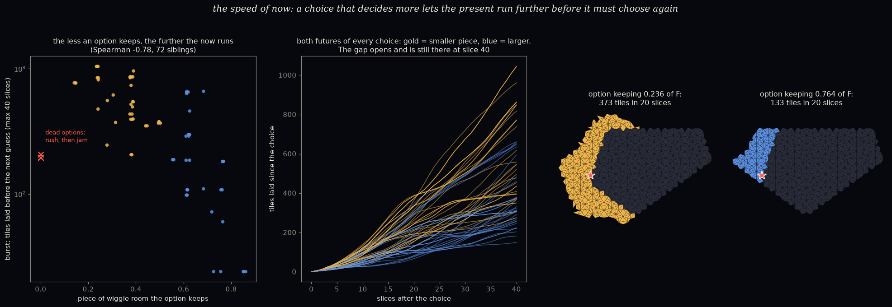

# The speed of now: why do some choices make the present rush ahead?

*A pre-registered study. The pre-registration was committed before any code:
[`PREREGISTRATION.md`](PREREGISTRATION.md).*

**Why.** In `thread_influence/` we noticed that after a two-way choice, the two alternative presents
can advance at very different speeds: one laid 24 tiles before needing another guess, the other 90. So
the "speed of now" (tiles laid per slice) is not fixed. A choice can speed it up or slow it down. What
sets it, and does it last?

**The set-up.**

- 24 fresh ordinary worlds were grown with the patient scheduler.
- At each of the 70 two-way choices, both options got their own future, grown 40 slices ahead.
- For each future, we measured three things:
  - its **burst**: tiles laid before it next has to guess;
  - the **piece** of the wiggle room F it keeps;
  - its tiles over time.

## Scorecard

| | prediction | result | |
|---|---|---|---|
| S1 | the option keeping the **smaller** piece of F has the larger burst (≥ 70% of choices) | **60 / 67** (90%); distinct choices only: 29 / 36 | ✅ HELD |
| S2 | the speed difference evens out (late-rate gap uncorrelated with burst gap, \|ρ\| ≤ 0.2) | ρ = **+0.72** | ❌ FAILED |
| S3 | the head start fades (total gap at slice 40 < half the burst gap, in ≥ 60%) | **25 / 67** | ❌ FAILED |

*A note on counting:*

- Different worlds often met **exactly the same choice** (the same local situation, with identical
  futures), so the 67 live choices are only 36 distinct ones. That is our twins again: similar
  situations recur everywhere.
- Counting each distinct choice once gives S1 29/36 and S2 ρ = +0.72. S3 is 8/36, so it fails even more
  clearly.

*Left: each future's burst against the piece of wiggle room it keeps. Middle: tiles laid slice by
slice for both futures of every distinct choice. Right: one choice drawn after 20 slices. The option
that decides more (gold) has laid tiles all the way along the front, while the other (blue) has only
filled in near the choice point (red star).
([`figure_EXPLORATORY.py`](figure_EXPLORATORY.py))*

## What it means (plainly)

- **A choice that decides more lets the present run further.**
  - Every choice splits the wiggle room into two golden pieces. The option that keeps the *smaller*
    piece (the one that pins the hidden position down more) almost always sets off a long run of
    forced tiles.
  - The trend runs right across the shares (Spearman −0.78 between piece kept and burst):
    - keeping 0.146 of F gives a burst of ~770 tiles;
    - keeping 0.854 gives a burst of 24.
  - The smaller-piece future needed a guess in its 40 slices only 9% of the time. The larger-piece
    future needed about one guess each.
- **It isn't only the pauses.** Even comparing the same slices while both are still running on forced
  tiles alone, the decided future lays about **twice as many tiles per slice** (14 vs 8). The picture
  shows why: its forced tiles spread **all along the front**, while the other only fills in locally.
- **It lasts, at least 40 slices.** Both "it evens out" predictions failed. Over the slices we watched,
  the faster future stays faster and keeps its lead. *But this is partly our window being too short:*
  most smaller-piece futures were **still in their first burst at slice 40**. We never saw them stop,
  so we can't yet say whether the speeds even out eventually.
- **Dead options rush, then die.** In the three choices where one option was impossible (F empty), the
  doomed option laid ~200 tiles in 13 slices and then jammed. Its live sibling laid only 4 tiles before
  needing the next guess. The impossible future is the fastest of all, right up until it can't go on.

## The "how come?" we haven't answered yet

- **This is not a general "more pinned = faster" law.** An exploratory follow-up
  ([`pinned_speed_EXPLORATORY.py`](pinned_speed_EXPLORATORY.py)) followed each main world through its
  history.
  - Each time a choice shrank F, the share of the front laid per slice went **up only 25 times and down
    41 times**.
  - That comparison is muddied by the world growing (bigger patches lay a smaller share of their front
    per slice). Still, it means the rule is about **the two futures of one choice, compared at the
    same moment**, not about a world's overall pinnedness.
- **A guess at the mechanism (not tested):** Conway's **empire**, i.e. the tiles a patch forces around
  itself. The rarer an option, the smaller its region of the hidden window, and the more of its
  surroundings it dictates. A rarer option would then have a bigger empire, and its empire spreads
  along the front.
- *If that's right, the speed of now is set by how* ***surprising*** *the choice was.*

## Limits

- Ordinary worlds only, one scheduler, and futures watched for 40 slices only.
- The burst was capped at 40 slices, and most smaller-piece bursts hit the cap. So their bursts are
  underestimates, and the late-rate window (slices 21–40) was often still inside the burst.
- The guesses in the two futures share a random stream but land in different places, so the long runs
  are not perfectly paired.
- Repeated identical choices inflate the raw counts. The distinct-only counts are given above.

## Files

- `speed_of_now.py`: the study. Writes `results/speed_of_now_report.txt`, `results/worlds.json`,
  `results/run.log`.
- `pinned_speed_EXPLORATORY.py`: the follow-up. Writes `results/pinned_speed_EXPLORATORY.txt` and
  `results/replay_EXPLORATORY.json`.
- `figure_EXPLORATORY.py`: writes `figures/speed_of_now.png`.
