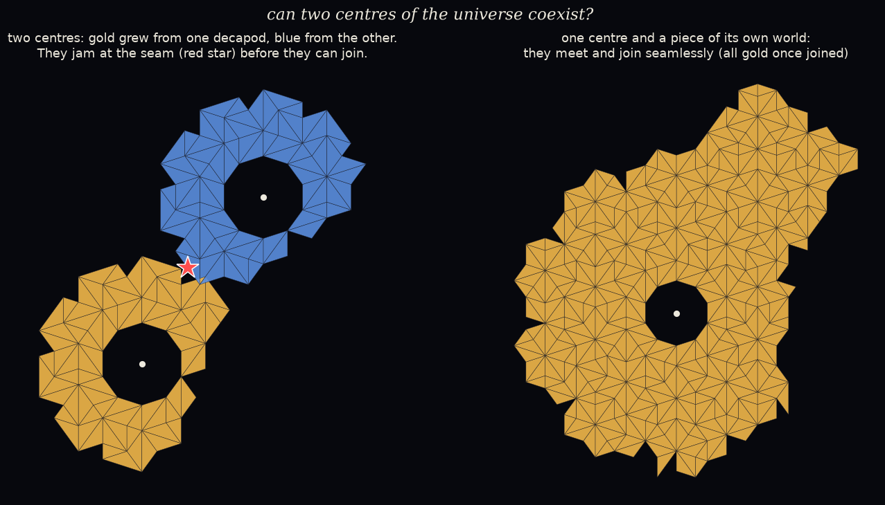

# Two decapods in one world: can two centres coexist?

*A pre-registered study. The pre-registration was committed before any code:
[`PREREGISTRATION.md`](PREREGISTRATION.md).*

*Two notes on how the run went:*

- *The first run crashed in the control part, before saving, because of a naming bug. It was rerun with
  identical code and seeds, apart from the fix.*
- *While checking the fix, I saw one control world early (seed 2, n 5, j 0: it merged at slice 8 with a
  point F).*

**Why.** A decapod pins its whole world to a single point in the hidden window: the centre of its
ring's decagon of possibilities. So what happens if a world holds **two** decapods?

**The set-up.**

- **TWO:** 32 worlds, each with two different decapod rings 8–11 edges apart.
- **CTRL:** 32 worlds, each with one decapod plus a small piece cut from *its own* grown world, at the
  same distance.
- Growth was forced-only.

## Scorecard

| | prediction | result | |
|---|---|---|---|
| T1 | merged TWO worlds have empty F, then jam (≥ 90%) | **no TWO world merged**: all 32 jammed *before* their halves could join | ❌ FAILED as registered (vacuous: nothing merged) |
| T2 | merged CTRL worlds keep a point F and don't jam (≥ 90%) | **32 / 32** merged (slices 8–20), F a point, no jam | ✅ HELD |
| T3 | TWO jams happen at the seam (median distance from the A–B bisector < 2 edges) | median **0.46** edges (range 0.02–1.83) | ✅ HELD |

*Left: a TWO world at its jam. Gold grew from one decapod, blue from the other, and the red star
marks where growth became impossible. Right: a CTRL world, where the decapod absorbed a piece of its
own world seamlessly. ([`figure_EXPLORATORY.py`](figure_EXPLORATORY.py))*

## What it means (plainly)

- **Two centres can't coexist. They can't even touch.**
  - In all 32 two-decapod worlds, the two growing regions jammed at their **first meeting**, almost
    exactly halfway between the two centres, before they could join into one world.
  - Each decapod pins the world to its own centre, and two different centres are incompatible.
  - The incompatibility shows up locally, right where the two meet: no tile can fit the seam.
- **One world always rejoins itself.** A decapod meeting a piece of its own world joined seamlessly
  in all 32 cases, and the world stayed pinned to one point.
- **For the "decapod as mass?" question:** a decapod behaves like a **world-organising centre**, not a
  thing that can sit beside another of its kind. It fits Astra's "organising seed" reading better than
  "particle".
- **What it doesn't show:** that decapods are special here. *Any* two pieces pinned to incompatible
  positions in the window might clash like this. A control with two incompatible *ordinary* pieces
  would tell the difference.
- **T1 failed as worded:** I predicted the clash would come *after* merging, and it came before. The
  result is stronger than predicted, but the registered test had nothing to test.

## Limits

- Only translations along two directions and two distances; B is always a different decapod type from
  A.
- Forced-only growth.
- The merged-F check couldn't run on TWO worlds, because they never merged.

## Files

- `two_decapods.py`: the study
- `figure_EXPLORATORY.py`: the picture
- `results/two_decapods_report.txt`, `results/run.log`, `results/worlds.json`, `results/worlds_two.json`
- `figures/two_centres.png`
