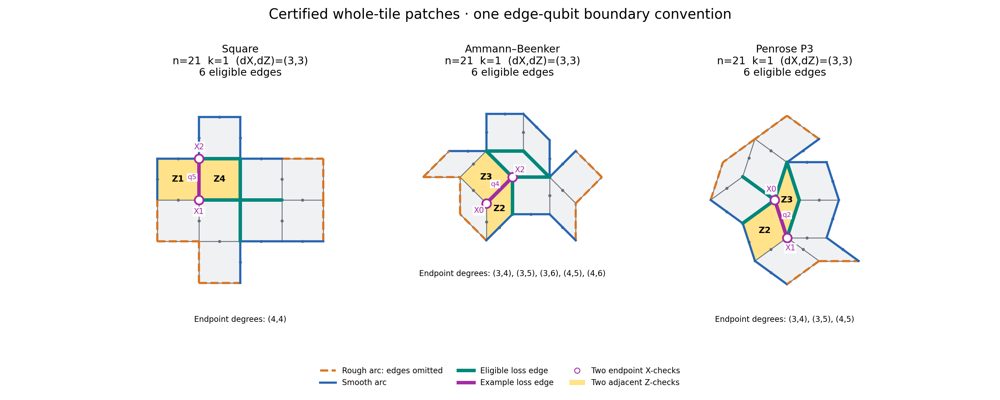

# Geometry pilot handback



**All three families met the target with exactly matched counts: 21 data qubits, one logical qubit, distances (3,3), and six eligible interior loss edges. No expanded-size search or fallback was needed.** Orange dashed edges are the omitted rough arcs; blue edges are smooth arcs. Teal and purple together mark all eligible edges. Purple singles out one example, its two circled endpoint X-checks, and its two yellow adjacent Z-checks. Each of those four check IDs is queried at rounds 1 and 2.

| Family | Data qubits n | rank HX | rank HZ | k | (dX,dZ) | Eligible edges | Endpoint-degree pairs |
|---|---:|---:|---:|---:|---|---:|---|
| Square edge-qubit | 21 | 10 | 10 | 1 | (3,3) | 6 | (4,4) |
| Ammann–Beenker | 21 | 10 | 10 | 1 | (3,3) | 6 | (3,4), (3,5), (3,6), (4,5), (4,6) |
| Penrose P3 | 21 | 10 | 10 | 1 | (3,3) | 6 | (3,4), (3,5), (4,5) |

Each patch comprises ten whole tiles and ten retained X-checks plus ten Z-checks. Natural endpoint degrees were preserved. All eligible Z-checks have weight four. In particular, an apparently interior edge was not accepted merely because it had two incident patch faces: both endpoint stars and both face boundaries were compared with the parent, then rechecked against enlarged parent tilings.

The geometry-only cut/selection rule was committed as `cbce124b645cb2e04b423e456ff9920af0334d11` before selection. It ranks n nearest 21, then eligible-edge count and degree-pair variety; these are intentionally feasibility-enriched examples, not randomly sampled patches. Search used the prescribed first 24 centres and whole-tile elliptical prefixes; exact selected specifications are stored in each JSON. The shared corner vertices belong to rough boundaries and have no X-checks. The patches are nonconvex but are connected, hole-free disks with simple four-arc rims.

The machine checker rebuilds HX/HZ from the saved incidence, verifies commutation and ranks, exhausts every weight-one/two support in both sectors, and validates explicit weight-three anticommuting representatives. It also checks the embedding, disk topology, all 18 eligible edges, four distinct check IDs per edge, and eight distinct check–round coordinates per edge. The square control is newly built under this same edge-qubit convention; it is not the earlier rotated-square QEC patch.

## Reproduce

From the repository root:

```sh
python3 exploratory/aperiodic_qec_geometry_2026-11-19/pilot.py
```

The command reruns selection, certificates and figures. Dependencies and exact source commits/paths are in [README.md](README.md). Main figure: `exploratory/aperiodic_qec_geometry_2026-11-19/results/patches.png`; an SVG and three individual labelled PNGs are alongside it. No decoder, archive-benefit measurement or heat map was run.

**Clean-checkout replay passed** at local code commit `a788d08`: exit 0, all three certificates passed, all **12 output files byte-identical** in the tested environment, and the detached checkout remained Git-clean. [REPLAY.json](REPLAY.json) records the full tested SHA, command, environment and hashes; [REPLAY.log](REPLAY.log) records the run. The subsequent delivery commit adds only documentation and replay evidence, with no generator/checker/figure-code changes. The verifier also rejected nine deliberately corrupted matrix, logical-support and query records. The initial development invocation reached selection before the plotting module was written; the final complete command was then tested from a clean checkout.

## Practical judgement for Opus

**Yes: proceed to a bounded next-stage decoder implementation/sanity run on these 18 sites.** Exact matching of n, ranks, distance and eligible-edge count makes these useful first controls, while the aperiodic stars supply degree variation that the square control lacks. This pilot gives no reason to revise the cut rule before that implementation run.

**Do not yet use these three patches as a predictor study.** Six sites within one patch are correlated, and the selection rule explicitly favours usable interior and degree variety. The later prediction study needs multiple frozen cuts per family and whole held-out patches. Before fitting perpendicular-space predictors, also freeze the coordinate normalization: AB's inherited octagon is translated, while Penrose uses four lift layers and an unshifted perpendicular projection with explicit gamma. Those conventions are preserved, not silently harmonized. The next stage should test whether boundary proximity and cut shape confound any degree effect before treating it as a geometric predictor of archive benefit.
