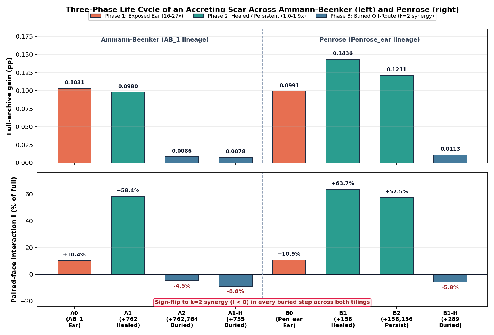

# Healing and Burying a Live Scar: Three-Phase Accretion Dynamics and Burial-Induced Synergy in Aperiodic Surface Codes

**K. T. Niedzwiecki**  
Independent Researcher, South Australia (`niedzkatie@gmail.com`)  
26 November 2026 *(Draft v0.1 — working manuscript)*

---

## Abstract

In a companion study of static aperiodic surface-code patches (*Which Old Readings Matter?*), we showed that a protruding degree-2 **Corner Ear** concentrates omission cost onto its partner **Hallway** face (16–27×) and suppresses mutual face backup $I$ to ~10–11%, whereas **Mirror Middle Yards** share the load and maintain ~56–63% mutual backup. Here we move from frozen static snapshots to **step-by-step boundary tile accretion** around the exact same physical lost edge on both Ammann–Beenker (`AB_1`, `e14`) and Penrose (`Penrose_ear`, `e13`) patches. All six growth steps were pre-registered before scoring and evaluated exhaustively ($k \le 2$ ordinary faults; `(3,3)` decoder, $p = 0.001$; **2,415,288** new site-histories, **0** full-scan mismatches). Every directional prediction held (6-for-6), revealing a universal **three-phase life cycle** of an accreting scar and an exact **$k = 2$ sign-flip from backup to synergy**:

- **Phase 1 → Phase 2 (Healing under one-tile accretion):** Adding a single tile onto the exposed Corner Ear eliminates its degree-2 tip while keeping the lost edge on a shortest weight-3 $X$-logical (`n_w3_on = 1`). Instantly, the bottleneck heals (`16.14× → 1.90×` on AB step `A1`; `26.67× → 1.02×` on Penrose step `B1`) and mutual face backup $I$ jumps 5–6× from **~10–11%** to **+58.4%** (`A1`) and **+63.7%** (`B1`). Extending the outer ring behind the healed face (`B2`, +2 tiles) preserves this healed state cleanly (`+0.1211 pp`, `99.38%` Narrow Now, `1.03×`, $I = +57.5\%$).
- **Phase 2 → Phase 3 (Dissipation under burial):** Accreting tiles until *either* the Corner Ear (`A2`) *or* the Hallway (`A1-H`, `B1-H`) is completely buried into the bulk (`bndS = 0`, 4 neighboring $Z$-faces) forces the shortest weight-3 $X$-logical to detour away (`n_w3_on = 0`). Full-archive gain collapses **9–13×** (`+0.0078` to `+0.0113 pp`), Narrow-Now local recovery drops from **98–99%** to **65–66%**, and scar asymmetry vanishes — even when the Corner Ear remains exposed (`A1-H`, `B1-H`).
- **Burial flips mutual backup into genuine two-sided synergy ($I > 0 \to I < 0$):** In every buried step across both tilings, the paired-face interaction flips cleanly negative (**`-4.47%`** in `A2`, **`-8.77%`** in `A1-H`, **`-5.77%`** in `B1-H`). Forensic replay proves this sign-flip is **100% purely $k = 2$** ($k = 0$ and $k = 1$ contribute literally `0.00000000 pp`) and is driven by **$k = 2$ straddling faults** — one $X$-fault on the Hallway face and a second $X$-fault on the Ear face at different early rounds — acting through two exact synergy modes: pure AND-gates (`[1,0,0,0]`) and one-sided-witness misleads (`[1,1,0,1]` / `[1,0,1,1]`).

---

## 1. Introduction

When a surface-code patch loses a data qubit, how does the memory signature of that loss evolve as the surrounding lattice grows? Static comparisons between `AB_1` and `AB_bal` (and between `Penrose_1`/`Penrose_2` and `Penrose_ear`) established that local boundary shape — specifically whether an adjacent $Z$-face forms a protruding degree-2 **Corner Ear** or a balanced **Middle Yard** — governs both single-face omission asymmetry and paired-face mutual backup $I$.

Static snapshots, however, leave open the dynamical question: **what happens step-by-step when new tiles accrete directly onto a live scar?** Does a Corner Ear scar smooth out and heal when covered? Does burying the Hallway while leaving the Corner Ear exposed still dissolve the scar? And once a scar is buried off-route, how do its two flanking $Z$-faces interact?

To answer these questions cleanly without post-hoc selection, we pre-registered a 6-step accretion protocol (`PROTOCOL.md`, commit `c510bf5`) directly on top of our two verified Hallway-vs.-Corner-Ear baselines (`AB_1` and `Penrose_ear`), holding the **exact same physical lost edge** fixed at every step.

---

## 2. Pre-Registered Growth Protocol

Starting from `AB_1` (9 tiles, `n=21`, physical edge `e14`, Hallway `Z3` = parent tile `757`, Corner Ear `Z6` = parent tile `760`) and `Penrose_ear` (10 tiles, `n=21`, physical edge `e13`, Hallway `Z7` = parent tile `221`, Corner Ear `Z6` = parent tile `220`), we accreted legal adjacent parent tiles that preserve a topological disk, valid $k=1, d=(3,3)$ rough/smooth boundary conditions, and the exact same physical lost edge:

- **Ammann–Beenker sequence (`A0 → A1 → A2` + mirror control `A1-H`):**
  - `A1` (`+tile 762`, `n=18`): half-swallows Corner Ear `Z6` into a Middle Yard (`n_w3_on = 1`).
  - `A2` (`+tiles 762, 764`, `n=23`): completely buries Corner Ear `Z6` into the bulk (`bndS = 0, znbr = 4`, `n_w3_on = 0`).
  - `A1-H` (`+tile 755`, `n=19`): mirror control burying Hallway `Z3` (`bndS = 0, znbr = 4`, `n_w3_on = 0`) while leaving Corner Ear `Z6` exposed.
- **Penrose sequence (`B0 → B1 → B2` + mirror control `B1-H`):**
  - `B1` (`+tile 158`, `n=21`): half-swallows Corner Ear `Z6` into a Middle Yard (`n_w3_on = 1`).
  - `B2` (`+tiles 158, 156`, `n=23`): extends the outer ring behind the healed face without burying it (`n_w3_on = 1`).
  - `B1-H` (`+tile 289`, `n=24`): mirror control burying Hallway `Z7` (`bndS = 0, znbr = 4`, `n_w3_on = 0`) while leaving Corner Ear `Z6` exposed.

Before scoring a single decoder history, we froze three directional predictions: **P1** (`A1, B1` heal the 16–27× collapse and lift $I$ to ~45–65%), **P2** (`A2, A1-H, B1-H` collapse $G_{\mathrm{full}}$ toward off-route levels upon burial), and **P3** (`B2` preserves high gain, ~98%+ Narrow Now, balanced faces, and high $I$).

All six steps were scored with the unchanged `(3,3)` decoder (`w_dec = 3, w_frame = 3`, $p = 0.001$, `CorrectedPatchCode`, exhaustive $k \le 2$ ordinary faults) and passed deterministic unaccelerated full-scan verification with **0 mismatches** and `max_posterior_difference = 0.0`.

---

## 3. Results — The 6-for-6 Sweep and Three-Phase Life Cycle

Every pre-registered prediction (**P1, P2, P3**) held cleanly across both tilings (**2,415,288** new site-histories total):

| Step | Accretion action | `n` | `n_w3_on` | Full gain (`pp`) | Narrow Now | Hallway `%` | Ear `%` | Ratio | Neither $G_0$ | Backup $I$ (`%`) | Phase |
|---|---|---:|---:|---:|---:|---:|---:|---:|---:|---:|---|
| **A0** | `AB_1` baseline *(sealed)* | 21 | 2 | `+0.103101` | 97.25% | **15.54%** | **92.19%** | **16.14×** | 0.107% | **+10.4%** | Exposed Ear |
| **A1** | Half-swallow Ear (`+762`) | 18 | 1 | `+0.097999` | 98.68% | **72.30%** | **84.78%** | **1.90×** | 0.010% | **+58.4%** | **Healed** |
| **A2** | Full-bury Ear (`+762,+764`) | 23 | 0 | **`+0.008618`** | 66.11% | 30.15% | 32.02% | 1.06× | 0.520% | **-4.5%** | **Dissipated** |
| **A1-H** | Bury Hallway (`+755`) | 19 | 0 | **`+0.007794`** | 66.02% | 30.09% | 27.41% | 1.07× | 0.244% | **-8.8%** | **Dissipated** |
| **B0** | `Penrose_ear` baseline *(sealed)* | 21 | 2 | `+0.099118` | 98.83% | **14.23%** | **95.66%** | **26.67×** | 0.112% | **+10.9%** | Exposed Ear |
| **B1** | Half-swallow Ear (`+158`) | 21 | 1 | `+0.143573` | 99.40% | **81.37%** | **81.75%** | **1.02×** | 0.071% | **+63.7%** | **Healed** |
| **B2** | Extend outer ring (`+158,+156`) | 23 | 1 | `+0.121104` | 99.38% | **78.20%** | **78.76%** | **1.03×** | 0.067% | **+57.5%** | **Persistent** |
| **B1-H** | Bury Hallway (`+289`) | 24 | 0 | **`+0.011330`** | 65.32% | 32.19% | 27.51% | 1.14× | 0.156% | **-5.8%** | **Dissipated** |

Across both tilings, the accreting scar passes through three sharply separated regimes:
1. **Exposed Corner Ear (`A0, B0`):** High gain (`~0.10 pp`), 16–27× bottleneck collapse, weak backup ($I \approx +10\text{–}11\%$).
2. **Healed & Persistent (`A1, B1, B2`):** One tile onto the Ear heals the bottleneck (`1.02–1.90×`) and lifts mutual backup $I$ to **`+57.5–63.7%`**. Growing a second outer-ring tile behind the healed face (`B2`) preserves that state intact.
3. **Buried & Dissipated (`A2, A1-H, B1-H`):** Burying *either* side into the bulk forces the shortest weight-3 $X$-logical to detour (`n_w3_on = 0`), collapsing full gain 9–13× (`~0.008–0.011 pp`), dropping Narrow Now to **65–66%**, and **flipping $I$ negative (`-4.5%` to `-8.8%`)** in every buried step.

---

## 4. Forensic Proof of the Phase 3 Sign-Flip (Redundancy → Synergy)

Define the paired-face interaction as
$$I = (G_{\text{hall}} + G_{\text{ear}}) - (G_{\text{both}} + G_{\text{neither}}),$$
so $I > 0$ indicates **redundancy** (either face alone substitutes for the other) and $I < 0$ indicates **synergy** (both faces together outperform the sum of their individual gains over neither face).

### 4.1 Exact four-term and fault-weight decomposition

| Step | Phase | $G_{\text{both}}$ (`pp`) | $G_{\text{hall}}$ (`pp`) | $G_{\text{ear}}$ (`pp`) | $G_{\text{neither}}$ (`pp`) | $I_{k=0,1}$ (`pp`) | **$I_{k=2}$ (`pp`)** | **$I$/Full** |
|---|---|---:|---:|---:|---:|---:|---:|---:|
| `A1` | Phase 2 | 0.096708 | 0.083088 | 0.070855 | 0.000010 | — | — | **`+58.39%`** |
| `B1` | Phase 2 | 0.142706 | 0.117366 | 0.116831 | 0.000101 | — | — | **`+63.65%`** |
| **`A2`** | Phase 3 | 0.005698 | 0.002759 | 0.002598 | 0.000045 | **`0.000000`** | **`-0.000385`** | **`-4.47%`** |
| **`A1-H`** | Phase 3 | 0.005145 | 0.002136 | 0.002345 | 0.000019 | **`0.000000`** | **`-0.000683`** | **`-8.77%`** |
| **`B1-H`** | Phase 3 | 0.007400 | 0.003117 | 0.003647 | 0.000018 | **`0.000000`** | **`-0.000653`** | **`-5.77%`** |

In all three buried steps, $k = 0$ and $k = 1$ contribute **literally `0.00000000 pp` (0 histories)** to $I$. The entire sign-flip lives at $k = 2$, where synergy histories outnumber and outweigh redundancy histories (`405` vs. `366` in `A2`; `371` vs. `303` in `A1-H`; `453` vs. `381` in `B1-H`).

### 4.2 The straddling-fault mechanism and two synergy modes
Inspecting the highest-weight synergy configurations across all three buried steps reveals an identical physical motif: **a $k = 2$ straddling fault pair** with one $X$-fault on the Hallway face and one $X$-fault on the Ear face at different early rounds ($t = 0$ vs. $t = 2$, or paired with a round-1 `MZ` measurement error on the opposite face):
- **`A2`** (`lost q10`, `Z3=[5,6,7,10]`, `Z6=[10,11,14,15]`): `('X',5,0) + ('X',11/14/15,2)` and `('X',5,2) + ('X',11,0)`.
- **`A1-H`** (`lost q11`, `Z4=[6,7,8,11]`, `Z7=[11,12,15,16]`): `('X',6,0) + ('X',15/16,2)` and `('X',6,2) + ('X',15,0)`.
- **`B1-H`** (`lost q8`, `Z7=[8,9,18,22]`, `Z6=[7,8,13,17]`): `('X',9,0) + ('X',13/17,2)` and `('X',9,2) + ('X',13/17,0)`.

When the lost edge is on-route (Phase 2), a single $k = 1$ ordinary fault paired with the lost edge threatens a weight-3 $X$-logical, and *either* adjacent face alone can catch its timing — producing massive positive redundancy ($I \approx +58\text{–}64\%$). Once burial detours the weight-3 $X$-logical away (Phase 3), that $k = 1$ channel vanishes completely. The only histories where the lost edge's early archive still matters are $k = 2$ straddling faults spanning both faces, which act through two exact credit patterns `[c_both, c_hall, c_ear, c_neither]`:
1. **Pure AND-gate (`[1, 0, 0, 0]`):** `137` (`A2`), `130` (`A1-H`), `118` (`B1-H`) histories where both faces together decode right while either alone or neither fails.
2. **One-sided witness misleads (`[1, 1, 0, 1]` and `[1, 0, 1, 1]`):** `238` (`A2`), `199` (`A1-H`), `288` (`B1-H`) histories where keeping only one face reveals half of a two-sided timing puzzle and actively misleads the decoder relative to keeping neither, whereas keeping both resolves both sides cleanly.

---

## 5. Discussion and Scope

1. **Accompanying boundary re-cuts under accretion:** As in static role-reversal comparisons, adding tiles while preserving a valid $d=(3,3)$ code adjusts the outer rough/smooth boundary assignment and total qubit count (`n = 18–24`). All six steps preserve the exact same physical lost edge and incident parent tiles.
2. **Accuracy-level synergy:** Negative $I$ measures super-additive gain on tie-aware decoder accuracy; our forensic replay identifies the exact $k=2$ straddling fault histories carrying that synergy without claiming an information-theoretic decomposition.
3. **Bounded decoder scope and future scale:** Results hold for bounded `(3,3)` decoding, exhaustive $k \le 2$ ordinary faults at $p = 0.001$, on `d=(3,3)` AB and Penrose patches. Testing whether burial depth and dissipation time scale with code distance ($d = 5$) and front compactness is left to a dedicated scaling follow-up.

---

## 6. Provenance and Reproducibility

All scripts, pre-registered protocol (`c510bf5`), 6-step results (`8eec0bf`), and forensic outputs are archived on branch `experiment/dynamic-growth-scar-2026-11-25` at <https://github.com/kekekatie/geometric-impedance> (`exploratory/dynamic_growth_scar_2026-11-25/`).

---

## Acknowledgements

*[Placeholder — to be written in K. T. Niedzwiecki's own voice.]*

---

## References

1. K. T. Niedzwiecki, "Which Old Readings Matter? Local Geometry, Bottleneck Faces, and Zero-Net-Cost Steering in Aperiodic Surface Codes," Zenodo (2026).
2. E. Dennis, A. Kitaev, A. Landahl, and J. Preskill, "Topological quantum memory," *Journal of Mathematical Physics* **43**, 4452–4505 (2002).
3. T. M. Stace, S. D. Barrett, and A. C. Doherty, "Thresholds for topological codes in the presence of loss," *Physical Review Letters* **102**, 200501 (2009).
4. G. Baranes et al., "Leveraging qubit loss detection in fault-tolerant quantum algorithms," *Physical Review X* **16**, 011002 (2026).
