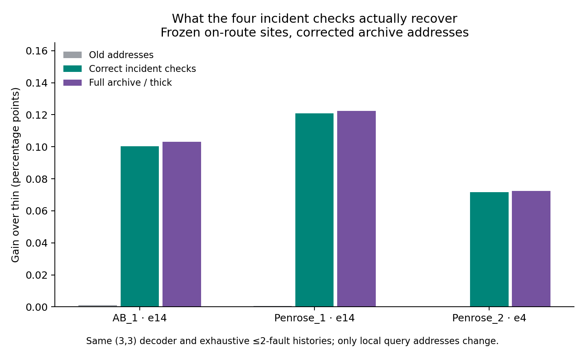

# Fresh-site address audit: the local recovery conclusion reverses



**All ten fresh sites had incorrect numeric local-query addresses.** After correcting them, the four incident checks recover **97.25%, 98.73%, and 98.97%** of the full-archive gain at the three frozen on-route sites. The geometry prediction about where forgetting hurts survives. The original claim that the four incident checks recover almost none of that benefit does not.

## Provenance and scope

Starting SHA: **`5506cd138495b62d50af2765ba1615718cd262b2`**. Original fresh-patch results remain at `fdeaa32a988224f98dc10b99175c99d806862522`. New branch: `audit/fresh-site-addresses-2026-11-20`.

Protocol and address audit were committed locally before replay (`807c23c`) and published as **[`91430382f41b5236832a378a55b5c4c2379e9dbe`](https://github.com/kekekatie/geometric-impedance/commit/91430382f41b5236832a378a55b5c4c2379e9dbe)**. The result commit containing this handback is its direct child. Original source files, geometry, selections and results are unchanged. A corrected adapter lives in this new experiment directory.

This is an exhaustive bounded `(3,3)` replay of all ten eligible sites in the three existing fresh patches. It is not a new geometry-selection study, cap study, or independent-patch population result.

## What the address audit established

All three certificates have rank_X = 11 and rank_Z = 9; their saved HX/HZ arrays have those row counts. The original `check_index` nevertheless used a fixed Z offset of 10. The actual named geometry was correct: at every eligible edge, the two endpoint X-checks and two adjacent-face Z-checks agree with the four nonzero matrix-column incidences. Their intended query coordinates also agree. The old adapter translated those names incorrectly; checking only that there were four checks/eight coordinates did not detect it.

The patch-aware mapper uses `len(HX)` for the Z offset, validates ID ranges, and asserts that the resulting STAR equals all matrix checks incident to the lost qubit. `results/address_audit.json` lists the intended names, original numeric addresses, actual old names and corrected addresses at every site. No score informed this correction.

Source anchors: `audit.py:11` (mapping), `audit.py:17` (corrected adapter), `audit.py:42` (geometric endpoints/faces), `audit.py:46` (matrix cross-check). The original defect is in `../aperiodic_decoder_pilot_2026-11-19/src/patch_code.py:31`, reused at `../aperiodic_predict_2026-11-20/src/paired_run.py:56`.

## Results

All gains/gaps are **percentage points** of model-weighted, tie-aware truth credit. Recovery percentages divide corrected diamond−thin by thick−thin; they are not overall decoder accuracy.

| Frozen on-route site | Thick−thin | Old diamond−thin | Corrected diamond−thin | Gap still left | Gain recovered |
|---|---:|---:|---:|---:|---:|
| AB_1 e14 | 0.103101 | 0.001236 | **0.100270** | 0.002831 | **97.25%** |
| Penrose_1 e14 | 0.122290 | 0.000719 | **0.120741** | 0.001549 | **98.73%** |
| Penrose_2 e4 | 0.072349 | 0.000350 | **0.071602** | 0.000747 | **98.97%** |

The complete ten-site before/after table is in **[results/table.md](results/table.md)**, with machine-readable **[summary.csv](results/summary.csv)** and **[summary.json](results/summary.json)**. Every original rounded per-site gain reproduced, including the legacy diamond. The independently repeated corrected Penrose_1 e14 credit totals exactly match the preceding follow-up.

The correction is not uniformly beneficial: at **Penrose_2 e1**, corrected diamond−thin is **0**, compared with the old **0.000387 pp**; full archive−thin remains **0.000701 pp**. This is a different equal-size query set, not adding evidence to the old one. The other off-route sites recover about 45.5–57.4% of much smaller archive gains. Do not extend “nearly all recovered” from the selected on-route sites to every site.

| Frozen pair | Full-archive gain: on minus off (pp) | Corrected local gain: on minus off (pp) |
|---|---:|---:|
| AB_1 e14 vs e8 | +0.099984 | +0.098786 |
| Penrose_1 e14 vs e13 | +0.119284 | +0.119017 |
| Penrose_2 e4 vs e0 | +0.069158 | +0.069933 |

The full-archive point contrasts reproduce. This audit does not recompute bootstrap intervals, establish new uncertainty intervals, or test cap sensitivity of corrected local queries. Penrose_1 remains the cleanest of the original matches; AB's endpoint degrees and Penrose_2's boundary distance were not exact matches. Matching the recorded features on Penrose_1 does not exclude all possible geometric confounding.

## Verification and replay

All **3,856,480 site-histories** completed: 385,648 per site, using the same 310-element ordinary-fault pool, exhaustive zero/one/two configurations, eight onset/free-value variants, p=.001, fixed per-patch scored logical, original XOR simulator, shared-onset inference and saved frame. Both local arms read exactly eight coordinates (rounds 1 and 2 of four checks) from the same site-independent archive. Only their query addresses differ.

* Whole archive versus thick: **zero mismatches** on every site-history.
* Explicit inferable round 0 for corrected incident checks: **zero mismatches in 3,856,480 comparisons**.
* **1,920 JSON round trips**, **5,760 direct checks**, **9,600 unaccelerated original-marginal comparisons** with empty caches: zero mismatches and maximum checked posterior difference 0. Unaccelerated checks are a deterministic sample, not a claim of full unaccelerated replay.
* Independent Decimal aggregation of **482,060 compressed CSV rows** reproduces all per-weight half-credit totals exactly and all weighted arm scores within 1e-14.
* Correcting the query set changed 14,096 labels, 190 tie flags and 14,206 truth credits across the ensemble. These are unweighted counts, not weighted gains.

`replay.py:49` serializes before selecting either query; `replay.py:78` checks the original full marginal. The exact necessary-evidence prefilter is imported from the preceding follow-up, which preserves candidate order and calls the original marginal. `report.py:11` independently aggregates the compressed CSV and generates the tables/picture.

One command from the repository root, with Python 3, NumPy and Matplotlib:

```sh
python3 exploratory/fresh_site_address_audit_2026-11-20/replay.py
```

The default **reruns** every site and regenerates the report. Add `--resume` to reuse completed checkpoints; `--patch AB_1` (or Penrose_1/Penrose_2) runs an independent patch job. For completed data, `python3 exploratory/fresh_site_address_audit_2026-11-20/report.py` verifies all CSV totals and regenerates the summary. `audit.py` separately regenerates the address audit. Runtime metadata varies on replay; compressed CSV metadata is deterministic.

## Wording to carry forward

**Supported:** “On the three prospectively selected fresh patch pairs, the bounded experiment reproduced a larger full-archive benefit at the on-route site. Correctly addressed rounds 1 and 2 of the four incident checks recovered 97.25–98.97% of that benefit at those three on-route sites.”

**Supported, narrower visual sentence:** “On the cleanest Penrose pair, the geometry prediction identified where forgetting hurt more, and the four incident checks recovered almost all of that benefit once correctly addressed.”

**Withdraw:** “The eight local readings recover essentially none of the on-route benefit,” and the inference that the missed benefit therefore lives delocalized outside those four checks. The incorrect addresses did not test that interpretation.

**Before further runs:** use `CorrectedPatchCode` from this audit (or port its patch-aware mapping and incidence assertion into the shared adapter). Do not silently overwrite the legacy result. Any later claim about corrected-local cap robustness needs its own corrected cap replay; this audit fixes and tests `(3,3)` only. Broader geometric prediction still needs independent cuts and held-out patches.
