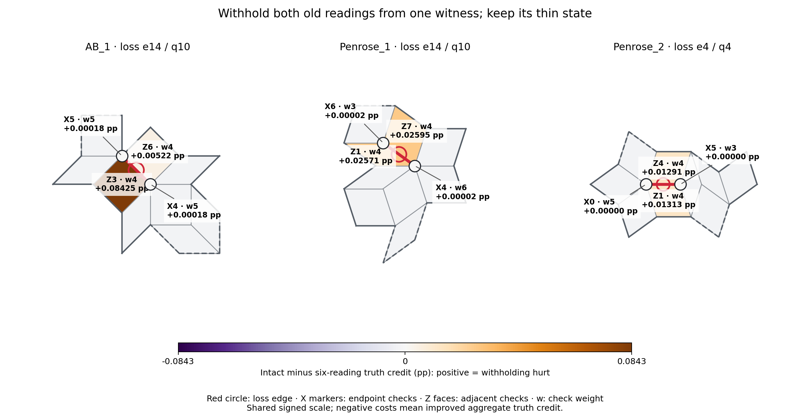

# Which old local readings matter?



**Point first to AB's dark Z3 face.** Withholding its two old readings costs **0.08425323 percentage points** of truth credit, leaving only **15.54%** of the full-archive gain. The other AB face, Z6, is much less costly. The two faces on each Penrose patch are closer in cost: losing either still leaves about **77.5–77.7%** of the full gain on Penrose_1 and **80.8–81.1%** on Penrose_2. Endpoint omissions have much smaller net costs, but the small/zero totals conceal decisions changing in both directions.

## Provenance and intervention

Start: **`1f85f7921bf9615bfa87173eb2d77d9159e211d3`**. Branch: `experiment/local-witness-omission-2026-11-20`. All original experiment files are preserved.

All twelve definitions, scoring rule and geometry-only picture were committed and published **before new scores** in **[`9434ea1d04c87ce28c77d1b059d3cde207e95911`](https://github.com/kekekatie/geometric-impedance/commit/9434ea1d04c87ce28c77d1b059d3cde207e95911)** (local protocol commit `fdf99a4`). The result commit containing this handback is its direct child. No winner was preselected. Result-picture layout was adjusted for legibility after scoring; frozen arm definitions and geometry-only image remain unchanged.

At each site we remove rounds 1 and 2 of one named incident check from the corrected archive query. Its physical measurements, ordinary faults, thin-state boundary parity, committed frame and live rounds 3/4 remain unchanged. Withheld observations are **absent coordinates**, not zeros. The other three checks supply their six ordinary archive readings. All arms use the same site-independent archive record. This is loss of access to a detailed earlier record, not deletion of a physical check or all information about that check.

## The twelve costs

All costs and gains below are **percentage points**. Cost = intact-local truth credit minus six-reading truth credit. Positive means withholding hurt. No negative aggregate costs occurred; the two exact zero costs are retained.

| Site | Omitted check | Role | Weight | Cost | Six-reading gain over thin | Full-archive gain over thin |
|---|---|---|---:|---:|---:|---:|
| AB_1 e14 | X4 | endpoint | 5 | +0.00018442 | +0.10008587 | +0.10310117 |
| AB_1 e14 | X5 | endpoint | 5 | +0.00018442 | +0.10008587 | +0.10310117 |
| AB_1 e14 | Z3 | face | 4 | **+0.08425323** | +0.01601706 | +0.10310117 |
| AB_1 e14 | Z6 | face | 4 | +0.00521915 | +0.09505114 | +0.10310117 |
| Penrose_1 e14 | X4 | endpoint | 6 | +0.00001844 | +0.12072270 | +0.12229029 |
| Penrose_1 e14 | X6 | endpoint | 3 | +0.00001844 | +0.12072270 | +0.12229029 |
| Penrose_1 e14 | Z1 | face | 4 | +0.02570844 | +0.09503270 | +0.12229029 |
| Penrose_1 e14 | Z7 | face | 4 | **+0.02594819** | +0.09479295 | +0.12229029 |
| Penrose_2 e4 | X0 | endpoint | 5 | **0** | +0.07160188 | +0.07234878 |
| Penrose_2 e4 | X5 | endpoint | 3 | **0** | +0.07160188 | +0.07234878 |
| Penrose_2 e4 | Z1 | face | 4 | **+0.01313085** | +0.05847102 | +0.07234878 |
| Penrose_2 e4 | Z4 | face | 4 | +0.01290955 | +0.05869233 | +0.07234878 |

Reproduced intact gains: AB_1 **0.10027029 pp**, Penrose_1 **0.12074114 pp**, Penrose_2 **0.07160188 pp**. Thin, intact, thick and whole credits **and tie counts by fault weight exactly match the preceding audit**.

## Small net costs can conceal movement

The complete **[twelve-row movement table](results/table.md)** includes weighted credit lost and gained separately, plus unweighted label/tie-status changes. **[omissions.csv](results/omissions.csv)** also supplies weighted label/tie-change percentages; **[summary.json](results/summary.json)** and per-site JSONs retain full precision and per-weight totals.

* **AB Z3:** loses **0.13321729 pp** and gains **0.04896406 pp**, net cost **0.08425323 pp**; 4,785 labels and 4 tie statuses change.
* **Penrose_1 X4:** loses **0.02107022 pp** and gains **0.02105178 pp**, net cost only **0.00001844 pp**; 570 labels and 12 tie statuses change. X6 has the same net cost but different underlying changes (572 labels).
* **Penrose_2 X0:** loses and gains **0.00008760 pp** each; net zero with 18 label and 2 tie-status changes. **X5** loses and gains **0.00020747 pp** each; net zero with 44 label and 2 tie-status changes.

Thus zero net cost is not “no decisions changed.” These are truth-credit movements relative to intact, not just disagreements with a reference label. Half-credit tie changes are included. “Same net cost” also does not mean equal posterior distributions or the same individual histories.

## Validation

All **1,156,944 site-histories** completed (385,648 per site), using the original `(3,3)` decoder, p=.001, fixed scored Z observable per patch, shared-onset inference, XOR simulator, exhaustive zero/one/two ordinary faults and eight onset/free-value variants. Exact geometry-derived six-coordinate sets were checked before scoring with the corrected adapter's matrix-incidence assertion.

Before credit accumulation, a deterministic sample (every 2,003rd history) checked **2,304 omission comparisons** against independently restricted full records and the original **unaccelerated** marginal, with empty caches: **zero mismatches**, maximum posterior difference **0**. The sample explicitly retained **10,167 known-zero readings** while leaving omitted coordinates absent. Boundary parity and live observations remained present. An initial partial attempt was discarded so the final scored runs all completed this preflight first.

During scoring, the same deterministic sample checked all eight arms: **4,608 direct/full-marginal comparisons**, zero mismatches, maximum posterior difference 0; **576 JSON round trips**; **2,304 omission-coordinate assertions**. These are sampled full-marginal checks, not an exhaustive unaccelerated replay or a separately restarted decoder process. Whole archive and thick agree on every scored history.

Independent Decimal aggregation of **144,618 per-configuration CSV rows** reproduces exact credit/movement totals and weighted scores. It checks `intact−omission = lost−gained` both per configuration and after weighting. The fault-stream hash matches the preceding audit. Compressed CSVs retain all paired contributions for further inspection.

Source anchors: `prepare.py:11` defines the sites/arms from geometry; `replay.py:15` constructs independent restricted evidence, `:24` runs the preflight, `:64` calls it before credit accumulation, `:89` records separate gained/lost credit, and `:125` checks prior baselines. The decoder and corrected adapter are imported unchanged from the pinned ancestry; only this new experiment directory is modified.

## Replay and next interpretation

From repository root, with Python 3, NumPy and Matplotlib:

```sh
python3 exploratory/local_witness_omission_2026-11-20/replay.py
```

Default reruns all three sites; `--resume` keeps completed checkpoints. `--patch AB_1` (or Penrose_1/Penrose_2) selects an independent job. `report.py` independently verifies saved rows and regenerates tables/figures. See README for file formats. No rescue-address or longer-lag experiment was added.

**Most affordable old record to lose:** AB's X4 or X5 (tied); Penrose_1's X4 or X6 (tied); Penrose_2's X0 or X5 (tied at zero net cost).

**Least affordable:** AB Z3; Penrose_1 Z7, only slightly worse than Z1; Penrose_2 Z1, only slightly worse than Z4. The common observed role is a **Z-type adjacent face**, while endpoints are X-type. This is compatible with the fixed scored Z logical being sensitive to X faults, whose syndrome is measured by Z checks; X-check information can still affect common-onset inference. It is not an isolated causal comparison of geometric role independent of check type or observable.

**Pointing at the pictures:** “AB strongly depends on the old record at this dark Z3 face. On these two Penrose cuts, either face matters, but the other three checks still carry most of the recovery. The endpoint records cost little in the average, yet covering them still moves some decisions.” One AB cut and two Penrose cuts establish these site-specific outcomes, not a family-wide difference. Fresh cuts are needed for that claim.
