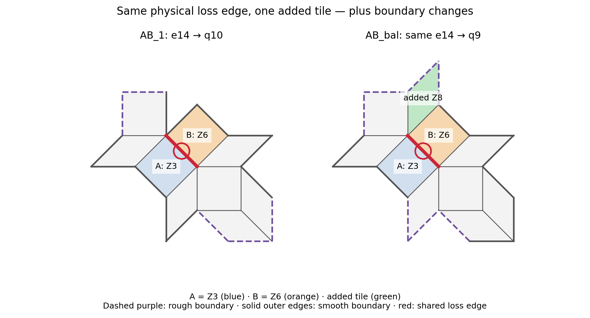

# Put a finger back on the same edge: what is verified?

**Yes: the physical loss edge is identical, and the second tile set is exactly the first plus one tile.** The comparison also changes rough/smooth boundary assignments, stabilizer supports and the chosen scored logical representative. It is not an isolated tile-addition intervention with the rest of the code held fixed. This audit does not assign a cause to AB_bal's residual 1.96× face-cost ratio.

Inputs: `exploratory/aperiodic_predict_2026-11-20/results/AB_1.json` and `exploratory/role_reversal_omission_2026-11-22/results/AB_bal.json`, both at `6236920f087a223ca3c0d701640afbe2a89ce5e7`. `geometry_audit.py` aligns exact parent-lattice integer lift tuples; it also checks the common projected positions within 1e-12. Complete supports, index mappings and changes are in `results/geometry_audit.json`.

## The common edge and the two physical faces

| Cut | Geometric edge | Decoder qubit | Endpoint X-checks | A | B |
|---|---:|---:|---|---|---|
| AB_1 | e14 | q10 | X4, X5 | Z3 | Z6 |
| AB_bal | e14 | q9 | X2, X3 | Z3 | Z6 |

Both loss endpoints have the same lift and coordinates in both cuts:

* `(0,1,2,-1)` at approximately `(1.414213562373095, 2.0)`.
* `(0,1,2,0)` at approximately `(0.707106781186548, 2.707106781186548)`.

Face **A = Z3** has physical vertices `{(0,0,2,-1), (0,0,2,0), (0,1,2,-1), (0,1,2,0)}` in both cuts. Its decoder data support changes names from `{q5,q6,q7,q10}` to `{q3,q4,q5,q9}`; the physical data edges are unchanged.

Face **B = Z6** has physical vertices `{(0,1,2,-1), (0,1,2,0), (0,2,2,-1), (0,2,2,0)}` in both cuts. Its support changes names from `{q10,q11,q14,q15}` to `{q9,q10,q13,q14}`; again these are the same physical data edges.

The added tile is **new Z8**, with vertices `{(0,1,2,0), (0,1,3,0), (0,2,2,0), (0,2,3,0)}`. It shares a full edge with **B = Z6** (old/new e18), and another edge with Z1, which is not either named A/B face. It meets A = Z3 at only the common loss endpoint `(0,1,2,0)`, not along an edge. Old Z8 is a different physical face and becomes new Z9.

Tile counts increase 9→10, vertices 18→19 and geometric edges 26→28. All nine old tiles remain. The retained data-qubit count stays 21; check counts change **11 X / 9 Z → 10 X / 10 Z**.

## Boundary changes on existing physical edges

| Old edge → new edge | Old q → new q | Assignment before → after |
|---|---|---|
| e5 → e5 | q3 → none | smooth → rough |
| e6 → e6 | q4 → none | smooth → rough |
| e11 → e11 | none → q6 | rough → smooth |
| e17 → e17 | q13 → q12 | smooth → interior |
| e18 → e18 | q14 → q13 | smooth → interior |
| e22 → e24 | none → q17 | rough → smooth |

The two new outer edges are visible in the diagram as rough boundary. The four rough/smooth switches on pre-existing edges are additional changes beyond covering two old boundary edges with the added tile. Full edge identities are stored as endpoint-lift pairs in JSON. The q10→q9 change at the loss itself is renumbering; rough-edge data removal/addition elsewhere is a physical change in the code.

## Face neighbours and supports

* A = Z3 keeps neighbours `{Z0,Z2,Z6}` and sorted graph corner degrees `(3,3,5,5)`.
* B = Z6 gains the new Z8 neighbour: `{Z3,Z7}` becomes `{Z3,Z7,Z8}`. Its corner degrees change `(2,3,5,5)`→`(3,3,5,5)`. Its two smooth boundary edges become one; its physical weight-four data support is unchanged.
* Z1 gains new neighbour Z8; its weight-two data support stays physically unchanged.
* Z2 keeps its physical neighbours but its data-check weight changes 4→2 due to rough-boundary reassignment.
* Z4 keeps its physical neighbours; the old Z8 neighbour is simply renamed Z9. Z4's weight changes 2→3.
* Old Z8→new Z9 is physical-face identity preservation with index renumbering; its weight changes 3→4. Its physical neighbours remain Z4 and Z5.

Other retained faces have unchanged physical neighbour sets, check names and physical data supports. The JSON separately lists vertex rough-status changes and X-check renumbering, rather than treating all changed labels as new physical structure.

## Shortest X-logical supports through the common loss

Exhaustive GF(2) enumeration verifies no weight-one/two X logical and lists every weight-three support through the loss:

| Cut | Decoder support | Geometric edge support |
|---|---|---|
| AB_1 | `{q5,q10,q14}` | `{e7,e14,e18}` |
| AB_1 | `{q5,q10,q15}` | `{e7,e14,e19}` |
| AB_bal | `{q3,q9,q14}` | `{e7,e14,e20}` |

Old e19 and new e20 are the **same physical edge**. Thus the second old support survives physically, while the first does not. The old e18 exit becomes interior after adding the tile; the count of shortest supports through the loss changes two→one. This is a change in the logical-support set, not merely q renumbering.

The fixed scored Z representative also differs: old `{q8,q10,q2}` versus new `{q3,q1,q0}`. Their physical edge supports are recorded in JSON and are not equal. This audit neither isolates its contribution nor attributes the residual face-cost ratio to it.

Suggested factual wording for Neon: **“The larger cut contains exactly the original nine tiles plus one tile, and we evaluate the same physical loss edge. The new tile shares an edge with the former corner-ear face; the selected code also changes boundary assignments and has one rather than two shortest X supports through the loss.”** The geometry supports that sentence. It does not, by itself, establish that adding one tile alone caused the measured accuracy change.
