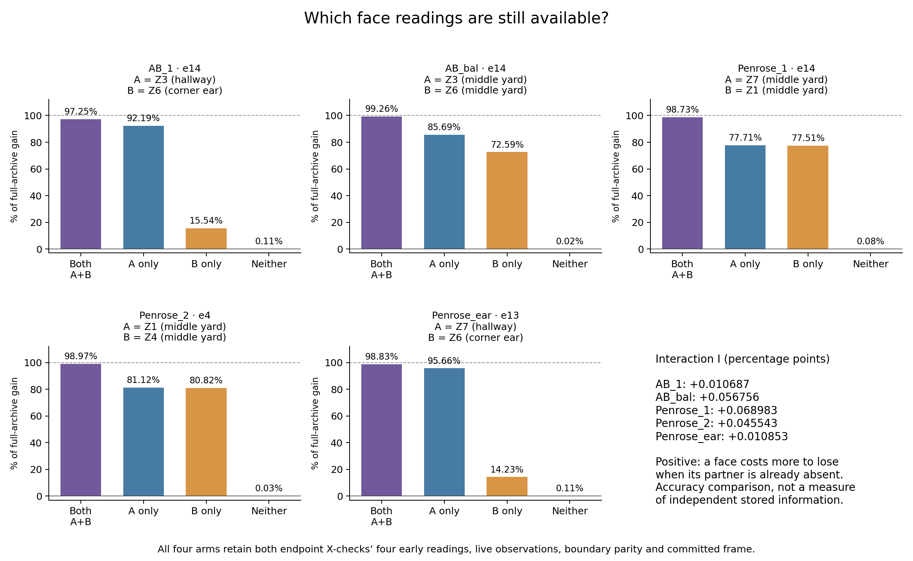
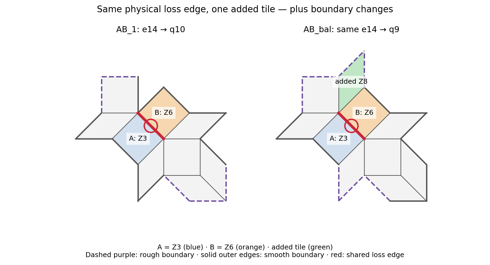

# Paired-face omission: what survives when both neighbours are covered?

**On Penrose_1, covering either middle yard alone left about 78% of the archive gain. Covering both left only 0.08294%. Either neighbour could stand in for much of the other's contribution to decoder accuracy while it remained available; the endpoint readings left after covering both recovered almost none of that gain. This is partial substitution on the accuracy score, not a measurement of duplicate or independent information.**



## Frozen setup and provenance

Starting commit: **`6236920f087a223ca3c0d701640afbe2a89ce5e7`**. Branch: `experiment/paired-face-omission-2026-11-23`. The no-directional-prediction protocol, all A/B assignments and exact coordinate sets were published before new scores at **[`1b95282be3837da01ae8ac859f561b99f38b0ef7`](https://github.com/kekekatie/geometric-impedance/commit/1b95282be3837da01ae8ac859f561b99f38b0ef7)**. The result commit containing this handback is its direct child.

Immutable inputs: [role-reversal code and results at 6236920](https://github.com/kekekatie/geometric-impedance/tree/6236920f087a223ca3c0d701640afbe2a89ce5e7/exploratory/role_reversal_omission_2026-11-22), and [corrected single-witness outputs at 1922a7b](https://github.com/kekekatie/geometric-impedance/tree/1922a7b7ff7e30f0ead0781ac6aaf3b924038783/exploratory/local_witness_omission_2026-11-20). The latter are byte-preserved in `inputs/` with commit/path/blob/SHA256 manifest because they are not in the starting branch's ancestry. All sealed experiments remain unchanged. Manuscript edits are left to Neon.

AB/A/B/0 mean the **faces kept**. All four arms keep both endpoint X-checks' four early readings, all live readings, boundary parities and committed frame. Withheld coordinates are absent. In particular, arm 0 is **not thin**, and thin itself is not literally memoryless: it retains summaries and frame information.

## All five results

Here G_0 is the gain with neither face retained; all gains and I are in **percentage points**. Percentages divide gains by that site's full-archive gain, not overall accuracy.

| Site | Fixed A / B | G_0 (pp) | Full gain surviving with neither | I (pp) |
|---|---|---:|---:|---:|
| AB_1 e14 | Z3 hallway / Z6 corner ear | +0.00011065 | **0.10732%** | +0.01068726 |
| AB_bal e14 | Z3 middle yard / Z6 middle yard | +0.00001844 | **0.01917%** | +0.05675590 |
| Penrose_1 e14 | Z7 middle yard / Z1 middle yard | +0.00010143 | **0.08294%** | +0.06898308 |
| Penrose_2 e4 | Z1 middle yard / Z4 middle yard | +0.00001844 | **0.02549%** | +0.04554303 |
| Penrose_ear e13 | Z7 hallway / Z6 corner ear | +0.00011065 | **0.11164%** | +0.01085324 |

All four gains, each as a percentage of the full gain, and all four conditional omission costs are in **[results/table.md](results/table.md)**. Machine-readable files: **[gains.csv](results/gains.csv)**, **[interactions.csv](results/interactions.csv)** and **[summary.json](results/summary.json)**. Calculations use unrounded values; signed values are preserved. All five interactions are positive, with substantially different magnitudes.

For **Penrose_1**, keeping both faces gains **0.12074114 pp**; A only gains **0.09503270 pp (77.711%)**; B only gains **0.09479295 pp (77.515%)**; neither gains **0.00010143 pp (0.08294%)**. Losing A costs **0.02594819 pp** while B is present, but **0.09493127 pp** after B is absent. Losing B costs **0.02570844 pp** while A is present, but **0.09469152 pp** after A is absent. Both differences equal **I = +0.06898308 pp**.

Thus the single-face omission costs do not partition the total recovery into fixed “shares.” One remaining face preserves much more gain than its intact-minus-single-omission cost suggests. Positive I is consistent with partial substitution **at the decoder-accuracy level**. It does not identify which histories carry that interaction, prove information-theoretic redundancy, or establish a universal geometric mechanism. In every tested site, the surviving endpoint records add very little over thin once both face records are covered.

## Baseline reproduction and validation

All **1,928,240 site-histories** were evaluated for the new joint omission, 385,648 per site, with the unchanged `(3,3)` decoder, p=.001, fixed scored logical per patch, original XOR simulator, shared-onset inference, weighting and tie rule.

* **AB_1, Penrose_1, Penrose_2:** reused the sealed per-configuration thin/thick/intact/single-face contributions after hash checks and exact re-aggregation. Credits and weighted scores match the sealed JSON literally. All eight variants of every 251st configuration were independently decoded again: 965 baseline-arm/configuration comparisons per site, zero mismatches. This is validated reuse, not a new exhaustive baseline decode.
* **AB_bal, Penrose_ear:** baselines were decoded on the full ensemble. Three printed gains differed from the sealed floats by only 1–2×10⁻¹⁴ pp, so the initial literal-equality gate stopped. Exact weighted half-credit arithmetic resolves them to the **same unique rational score**. [BASELINE_PRECISION.md](BASELINE_PRECISION.md) discloses the differences and proof; no baseline discrepancy is hidden by table rounding. Complete CSV recovery additionally repeated 965 baseline and 193 joint-arm configuration checks per site, all exact.
* **New arm:** 192 deterministic original unaccelerated full-scan comparisons per site, **960 total**, with **zero mismatches and maximum posterior difference 0**. Independent direct evidence construction verifies exactly four early endpoint coordinates, no early Z-face coordinates, and unchanged parity/frame. These are sampled posterior checks, not a full unaccelerated replay.
* **Independent arithmetic:** Decimal aggregation verifies **241,030 CSV rows**, exact per-weight half-credit totals and both identities `A_loss_without_B − A_loss_with_B = I` and `B_loss_without_A − B_loss_with_A = I`. Stream hashes match each site's sealed stream; the 11/9 and 10/10 check layouts naturally have different numeric coordinate streams, with identical pairing across arms within each site.

## The one-tile sentence



**The same physical loss edge and exactly one added tile are verified.** Both cuts call the edge e14; it maps to **q10 in AB_1 and q9 in AB_bal**. Its exact lift endpoints are `(0,1,2,-1)` and `(0,1,2,0)`, with identical projected coordinates. A=Z3 and B=Z6 are the same physical faces in both cuts, despite renamed qubit supports.

The added tile is **new Z8**. It shares an edge with **B=Z6**, another edge with Z1, and only a vertex with A=Z3. However, the selected code also changes four existing edges between rough and smooth, covers two old smooth edges into the interior, changes the check split 11/9→10/10, and changes some check supports. The shortest X supports through the loss change from two to one: one survives physically under new indices, the other disappears. The scored Z representative also changes physically.

See **[GEOMETRY_AUDIT.md](GEOMETRY_AUDIT.md)** for physical face supports, all boundary changes, face-neighbour changes, logical-support lists and the full mapping; **[geometry_audit.json](results/geometry_audit.json)** is machine-readable. The manuscript can ask readers to return to the same physical edge in a tile set enlarged by one tile. It should not imply that every other code feature was held fixed. **The cause of AB_bal's residual 1.96× difference remains open.** Neither global asymmetry nor observable placement was isolated by this follow-up.

## Replay

From the full repository root, with Python 3, NumPy and Matplotlib:

```sh
python3 exploratory/paired_face_omission_2026-11-23/replay.py
```

This regenerates the geometry audit, scores/checks all sites and renders the four-arm figure. `--resume` retains completed site checkpoints; `--site NAME` selects a site. `report.py` verifies existing CSV and redraws the result. README explains validated reuse and the recovery-only counters. No manuscript, rescue-address or longer-report-lag experiment was changed.
