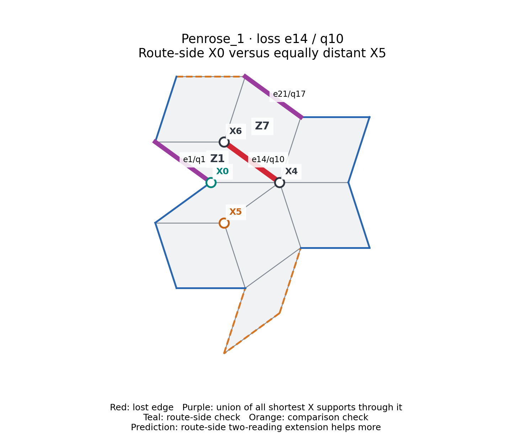

# Penrose e14: neither extra check buys truth credit



**Point to teal X0**, at the end of purple e1/q1. It touches the unique shortest X support through the red lost edge e14/q10: **{q1,q10,q17}**, or {e1,e14,e21}. Orange X5 is the matched off-route check. Asking either check for rounds 1 and 2 added **zero weighted tie-aware truth credit**. The frozen directional prediction failed in this one-patch, one-site mechanism test.

## Frozen choice and provenance

Starting SHA: **`fdeaa32a988224f98dc10b99175c99d806862522`**, then-current tip of `claude/aperiodic-predict-2026-11-20`. New branch: `experiment/penrose-e14-route-check-2026-11-20`. Original files are unchanged.

Prediction and figure were committed and published **before any new decoder scores**, in **[`3174b2350faf6cdfa89cd3f02da0eb7faa17d79f`](https://github.com/kekekatie/geometric-impedance/commit/3174b2350faf6cdfa89cd3f02da0eb7faa17d79f)**. That commit also froze the adapter discrepancy and the two separate baselines below. The result commit containing this handback is its direct child on the new branch.

Distance is the shortest unweighted path from q10 to a check in the mixed X/Z check–qubit bipartite incidence graph. Exclude the intended incident checks X4,X6,Z1,Z7. Enumerating the certified matrices gives no weight-one/two X logical and exactly one minimum X support containing q10.

| Candidates | Role | Type | Weight | Distance from q10 |
|---|---|---|---:|---:|
| X0, X3, X7 | Touch another route qubit | X | 3 | 3 |
| X5, X8 | Touch none of the route union | X | 3 | 3 |

These give six equally good matched pairs. Frozen numeric-ID tie-breaking selects **X0 ({q0,q1,q2}) versus X5 ({q4,q9,q15})**. Full external-check and pair lists, including less well-matched pairs, are in `results/prediction.json`. The prediction was X0 minus X5 > 0; no alternative pair was selected after scores.

## Scores and the address correction

All gains/gaps below are **percentage points**, not relative percentages. Scores are weighted, tie-aware agreement with simulated truth (ties get half credit).

| Query arm | Truth credit (%) | Gain over its diamond (pp) | Remaining gap to thick (pp) |
|---|---:|---:|---:|
| Thin | 99.767923245 | — | 0.122290286 |
| Thick / whole archive | 99.890213531 | — | 0 |
| Original implemented diamond | 99.768642491 | 0 | 0.121571040 |
| Original diamond + X0 | 99.768642491 | +0.000000000 | 0.121571040 |
| Original diamond + X5 | 99.768642491 | +0.000000000 | 0.121571040 |
| Correct incident diamond | 99.888664386 | 0 | 0.001549146 |
| Correct incident diamond + X0 | 99.888664386 | +0.000000000 | 0.001549146 |
| Correct incident diamond + X5 | 99.888664386 | +0.000000000 | 0.001549146 |

**Primary matched contrast: X0 minus X5 = 0 pp**, beside the original quoted **0.12157 pp** gap: **0% recovery**. The correctly mapped comparison is also 0 pp. Each extension's score equals its own diamond's score. This is a statement about truth credit, not a claim that all posterior probabilities are identical.

The original published rounded gains reproduce: thick−thin **0.12229**, implemented diamond−thin **0.00072**, thick−implemented diamond **0.12157**. The significant qualification is that the old `check_index` assumes ten X rows, while Penrose_1 has **eleven**. The original implemented diamond therefore reads **X4,X6,Z0,Z6**, not the pictured incident **X4,X6,Z1,Z7**. The correction changes only the two Z-check query addresses. Correct incident diamond−thin is **0.120741141 pp**, leaving **0.001549146 pp** to thick. Thus this site's original large gap is not evidence that the intended four incident checks miss almost all archive benefit. This follow-up does not rerun or revise other sites' results.

## Execution and verification

The original `(3,3)` decoder, p=0.001, fixed scored Z logical {q8,q10,q16}, common-onset inference, original frame and original fault model were retained. Exhaustively scored **385,648 histories**: 8 zero-fault, 2,480 one-fault, 383,160 two-fault, from **48,206 configurations**, each with the same eight onset/free-value variants. Ordinary faults and erasure contributions still combine through the original XOR simulator. Each extension obtains exactly two extra archive readings, selected-check rounds 1 and 2, from the same site-independent stored record.

* Whole archive versus thick: **0 mismatches** across all 385,648 histories.
* Explicitly supply inferred D0 = boundary xor D1 xor D2 for every queried check: **0 mismatches in 2,313,888 arm-history comparisons**; maximum posterior difference 0. This covers all six diamond/extension arms on every history.
* Every 2,003rd history: **192 JSON state round trips**, **576 original-direct comparisons**, **1,728 unaccelerated original-marginal arm comparisons** with an empty cache; zero mismatches, maximum checked posterior difference 0. Archive query-independence comparisons also had zero mismatches. This sampled check is not a claim of exhaustive unaccelerated replay.
* Independent Decimal aggregation of all **48,206 CSV rows** reproduces all nine arm scores within 1e-14; exact per-weight half-credit totals agree.
* Unweighted tie counts: thin and original diamond/extensions 0; thick/whole 14; correctly mapped diamond/extensions 12. Tie counts are not weighted error probabilities.

The accelerator prefilters on necessary live/boundary evidence, preserves candidate order and calls the original marginal; see `run.py:14`. Queries reconstruct evidence from the archive, not simulator truth (`run.py:43`). The driver and checks begin at `run.py:63`. Original source anchors (at the starting SHA): `aperiodic_decoder_pilot_2026-11-19/src/patch_code.py:31` (hardcoded offset); `aperiodic_predict_2026-11-20/src/paired_run.py:56` (reuse), `:70` (enumeration), `:80` (credit); `reconsideration_witness/distance5_2026-11-16/src/nd_infer.py:159` (shared-onset decision), `:193` (site-independent serialization). All these paths are under `exploratory/`.

## Replay and interpretation

From repository root, with Python 3, NumPy and Matplotlib:

```sh
python3 exploratory/penrose_e14_route_check_2026-11-20/run.py
```

This regenerates the prediction and machine-readable `results/scores.json` and `results/config_scores.csv`. Runtime metadata varies. Optional independent aggregation: `python3 exploratory/penrose_e14_route_check_2026-11-20/verify_scores.py`. Tested with Python 3.12.16, NumPy 2.2.6 and Matplotlib 3.10.6; exhaustive execution took about 11 minutes on this host.

X0 and X5 are X-checks: they constrain the conjugate Z-fault sector, and can affect the scored Z-logical prediction through common-onset inference. Touching a shortest X support is not itself a guarantee of useful X-error syndrome evidence. **This frozen pair provides no support for the proposed selection heuristic here**; it does not rule out other checks, sites or patches. Before extending the study, correct the general check-ID adapter and audit other affected patch/site queries. Do not carry the old e14 “four incident checks gain only 0.00072” sentence forward.

Katie: I would point to **teal X0** on the purple route. We asked it, and it bought **nothing in truth credit**; the equally distant orange X5 bought nothing either. The informative change came from querying the correctly addressed incident checks, not from either extension.
