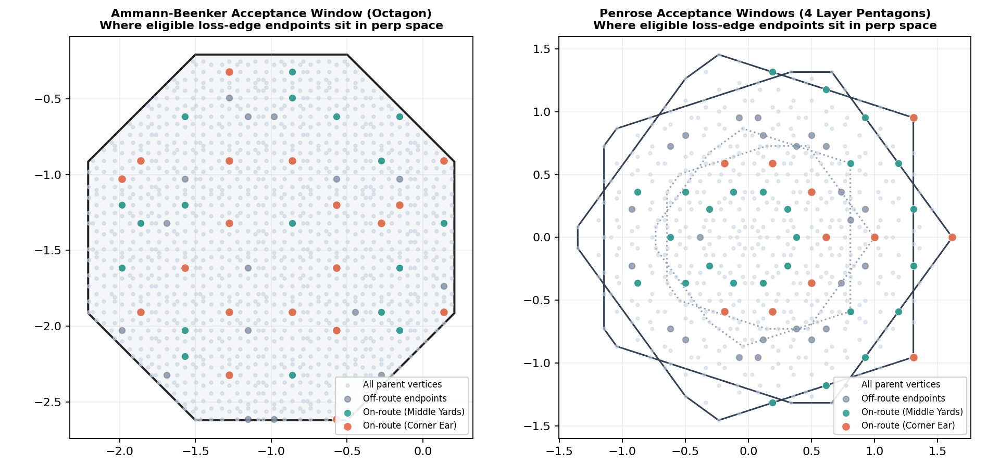

# Exploratory Lead Note: Perpendicular-Space Acceptance Window vs. QEC Decoder Behaviour

*Status: **CLOSED — CLEAN NULL** (3 matched `LZ`-crossing Rim-vs.-Center pairs scored across Penrose + AB; 2.31M site-histories, 0 mismatches). Branched cleanly off `claude/aperiodic-predict-2026-11-20` with zero sealed files modified.*

---

## 1. Complete Pool Scout (3,073 Frozen Cuts, 9,255 Eligible-Edge Instances)

Across all `1,282` AB (`3,892` eligible-edge instances) and `1,791` Penrose (`5,363` eligible-edge instances) `n=21, d=(3,3)` cuts from the frozen disk-cut pool (`exploratory/aperiodic_predict_2026-11-20/src/geom_select.py`), we computed each endpoint's exact Euclidean distance to the acceptance-window boundary (`window_margin`: AB octagon edge distance; Penrose layer-pentagon convex-hull edge distance):

- **Before controlling for endpoint degree (Simpson's paradox):** On-route edges appear deeper inside the window in both tilings (`AB`: mean `0.591` vs. `0.378`; `Penrose`: `0.352` vs. `0.302`) simply because shortest X-logical routes prefer higher-degree hubs, which live closer to the window center.
- **After holding exact endpoint degrees fixed:**
  - **AB:** The gap disappears (`(5,5)`: `0.7071` vs. `0.7071`, diff `0.0000`; `(4,6)`: `0.646` vs. `0.656`).
  - **Penrose:** The sign **flips** in **5 of 6** matched degree strata (`(3,4)`, `(3,5)`, `(3,6)`, `(3,7)`, `(5,6)`) — at *fixed* vertex degree, on-route Penrose edges actually sit **closer to the pentagon rim** than off-route edges of the exact same degree (for `(3,6)`, every on-route edge has `min_margin = 0.0000`, right on the pentagon rim).

---

## 2. Confound Catch: `scored_logical_Z` Placement Matters

An initial matched `(3,5)` Penrose Middle-Yard pair (`Penrose_rim` vs. `Penrose_center`, where `scored_logical_Z` crossed the lost edge on the rim cut but bypassed it on the center cut) produced `+0.1206 pp` vs. `+0.0729 pp` — mirroring `Penrose_1` (`+0.1223 pp`, `LZ` crosses lost edge) vs. `Penrose_2` (`+0.0723 pp`, `LZ` misses lost edge). Furthermore, bypassing the lost edge tilted single-face omission toward whichever face `LZ` threaded (`65.4%` vs. `97.1%`) while leaving mutual backup $I$ high (`62.9%`).

**Control rule established:** Any fair Rim-vs.-Center decoder comparison must hold **`scored_logical_Z` crossing the lost edge** fixed on both cuts.

---

## 3. Clean Matched Pair (`Penrose_rim_LZ` vs. `Penrose_center_LZ`)

Both cuts are **Penrose `10 X / 10 Z` Mirror Middle Yards**, identical endpoint degrees `(3, 7)`, identical mirror-twin corner degrees `((3, 3, 3, 7), (3, 3, 3, 7))`, identical boundary distances `(1, 1)`, unique weight-3 X-logical (`n_w3 = 1`), and **`scored_logical_Z` crossing the lost edge** on both:

- **`Penrose_rim_LZ`:** `spec=(15, 0, 0, 10)`, `corners=(4, 6, 10, 14)`, `e14 (q10)`, `LZ=[7, 10, 20]`, `min_margin = 0.0000`, `mean_margin = 0.3455`.
- **`Penrose_center_LZ`:** `spec=(15, 1, 0, 10)`, `corners=(7, 12, 16, 18)`, `e4 (q3)`, `LZ=[12, 3, 0]`, `min_margin = 0.5279`, `mean_margin = 0.6094`.

Exhaustive `(3,3)` decoder results (`385,648` histories/site, `p = 0.001`, `1,536` unaccelerated full-scan verification checks per site, **0 mismatches**, `max_posterior_difference = 0.0`):

| Measure | **`Penrose_rim_LZ`** *(fence, `min_m = 0.000`)* | **`Penrose_center_LZ`** *(center, `min_m = 0.528`)* |
|---|---:|---:|
| **Full-archive gain (`thick − thin`)** | **`+0.121516 pp`** | **`+0.099735 pp`** *(Rim `+21.8%` higher)* |
| **Narrow Now (`intact`)** | **99.45%** | **99.13%** |
| **Face omission (A / B)** | **78.61%** vs. **78.49%** *(1.01×)* | **73.39%** vs. **73.53%** *(1.01×)* |
| **Neither face ($G_0$)** | **0.0759%** | **0.0925%** |
| **Mutual backup $I$** | **`+0.069961 pp` (`57.6%`)** | **`+0.047572 pp` (`47.7%`)** |
| **Endpoint X-omission flips** *(both `0.000000 pp` net)* | **`74` (`X3`) & `68` (`X8`)** | **`0` (`X0`) & `0` (`X6`)** |

---

## 4. Replication Batch & Final Verdict: **CLEAN NULL**

Testing two additional clean `LZ`-crossing Mirror-Middle-Yard pairs — **Penrose `(3, 5)`** (`11 X / 9 Z`, corners `((3,3,4,5), (3,3,4,5))`) and **AB `(4, 5)`** (`11 X / 9 Z`, corners `((3,3,4,5), (3,3,4,5))`, a **12×** octagon-margin spread `0.054` vs. `0.638`) — cleanly falsifies any systematic Rim-vs.-Center effect in the `(3,3)` decoder (all `385,648` histories/site, `0` full-scan mismatches):

| Matched Pair (all Mirror Middle Yards, `LZ` crossing lost edge) | **Rim (fence)** | **Center (middle)** | Direction |
|---|---|---|---|
| **Pair 1: Penrose `(3, 7)`** (`10 X / 10 Z`, `0.000` vs. `0.528`) | `+0.121516 pp` · `I = 57.6%` · faces `1.01×` (`78.6/78.5%`) · ep flips `74/68` | `+0.099735 pp` · `I = 47.7%` · faces `1.01×` (`73.4/73.5%`) · ep flips `0/0` | Rim higher |
| **Pair 2: Penrose `(3, 5)`** (`11 X / 9 Z`, `0.000` vs. `0.427`) | `+0.075963 pp` · `I = 62.4%` · faces `10.5×` (`65.7/96.0%`) · ep flips `18/44` | `+0.121442 pp` · `I = 57.0%` · faces `1.03×` (`78.1/77.5%`) · ep flips `110/94` | **Reversed (Center higher)** |
| **Pair 3: AB `(4, 5)`** (`11 X / 9 Z`, `0.054` vs. `0.638`) | **`+0.123526 pp`** · **`I = 56.0%`** · faces **`1.01×`** (`77.3/77.0%`) · ep flips `128/130` | **`+0.122678 pp`** · **`I = 56.2%`** · faces **`1.03×`** (`77.9/77.3%`) · ep flips `46/42` | **Dead tie to 3 sig figs** |

### Takeaways (recorded so we don't retread this ground!)
1. **Clean Null:** Perpendicular-space window margin (`rim` vs. `center`) does **not** systematically control `(3,3)` QEC decoder gain, mutual backup $I$, or endpoint steering once 2D local graph geometry is matched. Pair 1 favored Rim, Pair 2 flipped to Center, and Pair 3 (12× AB octagon spread) tied to three significant figures.
2. **Bonus confirmation for the Bridge Paper:** Both new Ammann–Beenker Middle-Yard sites (`AB_best_rim` and `AB_best_center`) achieved **1.01×** and **1.03×** balanced face omissions (`77.3/77.0%` and `77.9/77.3%`) with **`I = 56.0% / 56.2%`** mutual backup — confirming that AB Middle Yards share the load just as evenly as Penrose Middle Yards.
3. **Next islands on the shelf:** **Distance-5 deep bulk** (where no boundary ears sit near the lost edge) and **Horizon Note §6** ($p(r)$ vs. Hankel admissibility cone).
