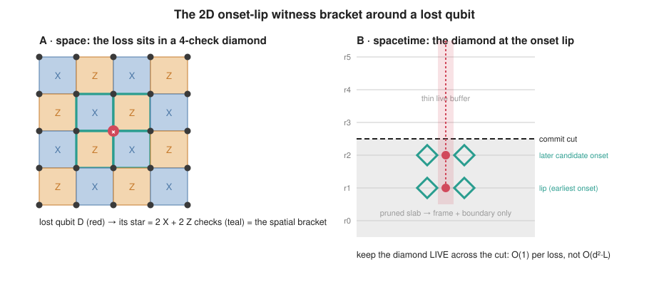

# The Skin Outlives the Archive

### Streaming syndrome pruning and delayed-erasure re-judgment in surface codes

**Draft manuscript — author list and affiliations to be finalized.**
Assembled 2026-11-18 from the committed experimental record on branch
`claude/distance5-feasibility-2026-11-16`, pinned at audit input `f8e15d8`. Every
number in this draft is pulled from a committed `HANDBACK_*.md` or results `.json`
on disk; where this draft departs from an earlier internal summary, it is because the
committed file or the Sol/Astra audit (`audit/pass2-paired-2026-11-17`) says so. Those
departures are listed in the *Verification and corrections* appendix.

---

## Abstract

A streaming surface-code decoder cannot keep every detector round forever. As the
syndrome history scrolls past, old rounds are *committed* — compressed into a boundary
"skin" (the live detectors at the cut) plus a one-shot logical *frame* verdict — and
then pruned. This is enough to keep correcting forward. But it is not obviously enough
to **re-judge the past**: when a hardware *erasure* (atom-loss) report arrives late,
after the early rounds it implicates have already been discarded, the decoder is asked
to reconsider a verdict using evidence it no longer holds.

We ask three operational questions of each pruned decoder against the full-record
decoder it is trying to stand in for — did it make the same *call* (agreement), did it
hold the same *evidence* (posterior, or an honest 50/50 tie), and did it get the *truth*
right (tie-aware scoring) — and we track how the answers change as the code grows. The
through-line is a single, slightly surprising law: **the living skin outlives the
archive.** On a one-dimensional repetition chain, the entire information a streaming cut
sheds at a realistic deadline is exactly a four-bit *onset bracket* around the lost
qubit; retain it and the pruned decoder becomes deadline-optimal. On the
two-dimensional distance-3 surface code, a universal sparse "fired-check" archive
reproduces the full record exactly while storing less, and a local bracket of the
checks touching the loss recovers virtually all of the archive's advantage — with a
non-monotonic twist: the two-check *corner* re-judges better than the three-check
*edges*, so sufficiency is governed by *position*, not bracket size. Scaling to
distance 5, the full archive's accuracy advantage over the thin record **collapses by
two orders of magnitude** (≈126× within double-fault histories), and what little
survives is almost entirely the archive *honestly declaring a 50/50 tie* on
seam-crossing logical ambiguities where the thin record simply guesses. A pre-registered
triple-fault sample shows this collapse is **not** a monotone march to zero: past the
two-fault "seam," the archive's decisive advantage re-awakens (+0.234 percentage points
within triple-fault histories). Finally, an independent paired audit of decoder caps
delivers the sharpest caveat of all: giving the *thin* decoder a larger frame table
before it discards the past can erase the archive's advantage on a diagnostic panel
entirely — so "the archive stops being worth keeping" is, at least in part, a statement
about how good the *summary* of the past is, not only about how much raw history you
throw away. We draw the operational bridge to a classical precursor on silent corruption
in aperiodic substrates, where *naming what does the looking* is likewise what makes
"silent" a rigorous statement.

---

## 1. Introduction: streaming syndrome pruning and delayed-erasure re-judgment

A fault-tolerant memory never stops. Stabilizer measurements stream in round after
round, and a streaming decoder commits to logical corrections as it goes, because it
cannot hold the entire detector history of a long-lived qubit in working memory. The
natural economy is to **prune**: once early rounds are safely behind the correction
frontier, discard the raw detectors and keep only what forward continuation needs — the
active boundary detectors at the commit cut (the "skin"), and a compressed logical
verdict (the "frame") distilled from the slab that was thrown away.

Forward, this is fine. The trouble is **retroactive**. Real neutral-atom and
ion-trap hardware reports *erasures* — qubits lost from the array — and these reports
can be **delayed**: the decoder learns that a specific qubit was missing *during rounds
it has already pruned*. A delayed erasure changes the prior over past fault paths, and
so it asks the decoder to **re-judge** a logical outcome it thought was settled. The
question this study is built around is deceptively simple:

> When the early rounds are gone, how much of the right answer can a pruned decoder
> still recover about a delayed erasure — and what, exactly, is the minimum it needed
> to keep?

### 1.1 Three questions, kept separate

Throughout, we score a pruned decoder against the full-record decoder it approximates by
asking three *distinct* questions, and we never let one stand in for another:

1. **Agreement.** Did the pruned decoder make the *same call* as the full-record decoder?
2. **Evidence.** Did it hold the *same posterior* `(p₀, p₁)`, or did it land on an exact
   50/50 tie (`|p₀ − p₁| ≤ 10⁻¹²`)? A decoder can agree on the call while holding very
   different evidence, and it can *honestly tie* where another commits.
3. **Truth.** Did it get the *true logical outcome* right? We score truth **tie-aware**:
   a strict win scores `1`, an exact tie scores `0.5`, a strict loss scores `0`. (The
   hard-label convention, which breaks ties toward `0`, is reported alongside; the two
   agree to six decimal places on every population estimate, so ties are not a
   scoring artifact — but they are a real *phenomenon*, as §4 shows.)

Keeping agreement, evidence, and truth apart is not pedantry. The single most repeated
lesson of this campaign is that **agreement with the record is not correctness**: across
every geometry we tested, roughly a third of the cases where the local bracket "disagrees"
with the full record are cases where the *bracket is right and the full record is wrong*.
The record is an optimal *soft* decoder, not an oracle.

### 1.2 Four memory architectures

We compare four ways of remembering the past across the commit cut. They differ only in
what they retain from the pruned slab; all decide at the same deadline, using the same
bounded decoder.

1. **Full unpruned record (`thick`).** Retains every detector round. This is the
   reference each pruned arm is measured against — a Bayes-optimal (within bounds) soft
   decoder with the whole history in hand.

2. **Pruned boundary + committed frame (`thin`).** Retains only the live boundary skin
   (the detectors at rounds `t−1, t` around the cut) plus the compressed logical `frame`
   verdict committed from the discarded prefix. The frame is **many-to-one**
   ("ensquished"): it is a MAP threshold that suffices for forward continuation when no
   new retrospective report arrives, but **cannot be inverted** when a delayed erasure
   re-weights the past. The thin record is the "skin" of the title.

3. **Universal sparse fired-check archive (`whole`).** Before the erasure location is
   known, stores only the *non-zero* detector events (`det = 1`, the "Oh!" events) in the
   pruned prefix, discarding the quiet checks (`det = 0`, the "Meh"). It is universal —
   site-agnostic — because it is written before anyone knows which qubit will be
   reported lost.

4. **Local onset-lip witness bracket (`diamond`).** Queries only the spatial *star* of
   checks immediately adjacent to the reported erasure, across the two onset rounds
   straddling the cut. It is the smallest, most targeted memory: a handful of detector
   readings around the lip of the loss. (Figure 1.)

**Figure 1.** The onset-lip witness bracket. *(A)* Spatially, the lost data qubit sits
inside a diamond of the stabilizer checks that touch it — in the bulk, two `X` and two
`Z` checks. *(B)* In spacetime, that diamond straddles the commit cut at the onset lip:
keeping it **live** across the cut costs `O(1)` per loss rather than `O(d²·L)` to retain
the whole slab. The bracket is the "reason" the thin frame's one-bit "verdict" cannot
reconstruct.

### 1.3 Relation to delayed-erasure decoding in hardware

Atom-loss-as-delayed-erasure is an active 2024–2026 line, and this toy is adjacent to it
rather than redundant with it. Using loss-detection information improves logical error
rates by roughly three orders of magnitude over a loss-blind decoder
([Perrin et al., arXiv:2412.07841](https://arxiv.org/abs/2412.07841)) — the real-world
form of our premise that the delayed report is worth keeping *something* for. A
maximum-likelihood delayed-erasure decoder with gauge-merged "superchecks" around the
lost atom is the hardware cousin of our local witness bracket. And the finding that
total loss exposure is the wrong figure of merit — that *position* on the code and its
decoder sensitivity are what count
([Li, Peng & Wang, arXiv:2608.17913](https://arxiv.org/abs/2608.17913)) — is a close
echo of our non-monotonic geometry result (§3): the corner beats the edges. Where those
works ask "how much does loss at position X hurt the *full* decoder?", we ask the
complementary question the Penrose framing is about: **how much does the full *archive*
buy you over the thin record and a local bracket, and how does that change as the code
grows?**

---

## 2. One-dimensional baseline: the repetition chain (Stages 0–1.6)

Before the surface code, the mechanism was isolated on a distance-3 repetition chain
(`T = 6` rounds, a single data-qubit loss at the boundary site, onset model
`O = {1, 2}`, decision at the flag-delivery deadline). The chain is small enough to
decode by exact Bayesian summation over all discarded/unobserved completions, which lets
us name the retained information exactly.

### 2.1 The two bits carry real, usable value — but do not fully heal at a deadline

A principled restorer that sees **only** the allowed inputs — the serialized streaming
state, the committed frame plus the two saved onset bits, and observations through the
deadline — **consistently beats both baselines** (a 0-bit restorer and ordinary hard
streaming). On the witness decisions it reaches `0.771` agreement with the full-record
reference, against `0.469` for both baselines; the ordering
`deadline-reference > restorer-2bit > baseline-0bit ≥ streaming-hard` holds on every
evaluation set and both onset models. The retained bits are usable by a real online
decoder, not merely a post-hoc lookup.

But under a *realistic* deadline the restorer recovers only ~80% of the full-record
reference on the witness decisions, not the ~100% an earlier, future-peeking analysis
implied. The honest decomposition splits the gap in two:

- **Deadline cost (~5%).** Even a pruning-free decoder that cannot see the post-deadline
  future agrees with the all-seeing reference only `0.953` of the time: a few decisions
  are only resolved by rounds that have not happened yet.
- **Pruning cost (~15–19%).** Against the deadline-optimal decoder (full core, no
  pruning), the two-bit restorer reaches ~0.81–0.85. Knowing the frame and the onset
  parity but not the individual pruned detectors genuinely costs accuracy once the future
  is unavailable.

This was itself a frozen-deadline correction to an over-optimistic "two bits suffice"
reading — the kind of thing only a pre-registered deadline surfaces.

### 2.2 The pruning gap *is* a four-bit onset bracket — and nothing else

Stage 1.5 then localized the entire pruning cost. Retaining the four detectors around
the lost qubit — `(c₀,t₀), (c₁,t₀), (c₀,t₁), (c₁,t₁)`, i.e. **two neighbouring checks
across two onset rounds** — makes the restorer reproduce the **deadline-optimal decoder
exactly**: agreement `1.000` with the deadline reference on every set and both onset
models, across all 7,188 histories of the primary (`ONSET_AVG`) ensemble. Because the
bracket plus the committed `m₂` pins the entire six-detector core to a single syndrome,
the committed `frame` bit becomes **100% redundant** (identical decisions with and
without conditioning on it, 7,188/7,188).

Two precise statements follow, and they are the conceptual seed of the whole program:

- **The "reason" is four bits; the "verdict" is one bit; they are different
  currencies.** The frame is a non-invertible MAP threshold. Three detector bits *plus*
  the frame do **not** reconstruct the fourth bit — they leave ~2 core candidates (mean
  1.88) and match the true bracket only 95.3% (`ONSET_AVG`) / 97.0% (`FREE_BOTH`). All
  four bracket bits are genuinely needed; the frame rides along for free once you have
  them but can substitute for none of them.
- **The residual ~5% is not pruning — it is unarrived future.** Bracket-4 equals the
  deadline-optimal decoder, so its only remaining gap to the omniscient end-of-record
  reference (0.953) is genuine future that has not happened at the deadline. *(We are
  careful here: the bracket restores the **deadline** reference exactly, not the
  omniscient one.)*

The lip geometry even predicts *which* onset pair matters: under the physically correct
`ONSET_AVG` model, the timing-parity bit `t₀ ⊕ t₁` — "when did it drop" — is the single
most informative two-bit summary on unbiased fresh data (`0.928`), as the onset-lip
picture argues. The effect is real but modest (~1–2%), and it is masked on the
constructed witness set, which was selected under a model where `t₀` happens to be the
splitting detector — a useful caution about scoring on a constructed ensemble that we
carry into the surface-code stress panels.

**What the chain establishes.** The information a streaming cut sheds, at a realistic
deadline, is *exactly* a small, local, spacetime bracket at the onset lip — not the
whole slab, and not something the one-bit verdict can regenerate. That is the claim we
now test in two dimensions and at growing distance.

---

## 3. Distance-3 surface code: bulk sufficiency and the geometry of re-judgment

We move to the rotated surface code at `d = 3` (Astra's corrected bounded-frame
`E_frame` model; a bounded ensemble of ≤2 ordinary faults plus the loss, 68,128 histories
per site). The loss is placed at four sites in turn — bulk `(1,1)`, the two mid-edges
`(1,2)` and `(2,1)`, and the corner `(2,2)` — and at each site every pruned arm is scored
against *its own* full-record `thick` reference.

### 3.1 The universal archive is free; the local bracket is nearly free

The sparse fired-check **`whole`** archive reproduces `thick` **exactly** — `0`
disagreements, posteriors within `10⁻¹²` — at **all four sites**, while storing less than
the full snapshot: at the bulk, mean deadline payload drops from `40` bits (`thick`) to
`36.4` bits, a 9% reduction, and smaller still at the edges (`33.97`) and corner
(`31.5`). (The local `diamond` happens to carry the same mean payload at these bulk-type
sites; the two archives differ in *query size* — the diamond reads 8 detectors in the
bulk, the whole archive reconstructs 24 — not in stored bits. The worst-case archive
payload can exceed `thick`'s fixed snapshot, which we flag rather than hide.)

At the **bulk** `(1,1)` site, the 8-bit, 4-check local diamond achieves `99.9962%`
weighted agreement with `thick`, disagreeing on only `341` of `68,128` histories —
`3.8 × 10⁻⁵` of probability weight. And on those 341 disagreements the diamond is right
against ground truth `36.0%` of the time (123/341): its truth accuracy (`0.995891`)
essentially equals the full record's (`0.995901`), both far above the thin record alone
(`0.993013`). The local skin is a faithful stand-in for the whole archive — in the bulk.

### 3.2 The corner overturns the bracket-size story

The four-site table is where the geometry speaks. Scoring each site's diamond against its
own `thick`:

| site | star arms | local readings | diamond disagreements (raw) | weighted disagreement with `thick` | diamond-right when they split | diamond truth / `thick` truth |
|---|---|---:|---:|---:|---:|---:|
| **bulk `(1,1)`** | 2Z + 2X | 8 | 341 | **0.0038%** | 123/341 = 36% | 0.995891 / 0.995901 |
| **Z-open edge `(1,2)`** | 1Z + 2X | 6 | 896 | **0.0428%** | 301/896 = 34% | 0.995523 / 0.995666 |
| **X-open edge `(2,1)`** | 2Z + 1X | 6 | 837 | **0.0970%** | 387/837 = 46% | 0.996618 / 0.996625 |
| **corner `(2,2)`** | 1Z + 1X | 4 | 753 | **0.0083%** | 237/753 = 31% | 0.996598 / 0.996629 |

Ordered by weighted disagreement:

> **bulk (0.0038%) < corner (0.0083%) ≪ Z-edge (0.0428%) < X-edge (0.0970%).**

Re-judgment difficulty is **non-monotonic in bracket size.** The site with the *fewest*
local checks — the two-check, four-reading corner — is the *second-best* site, five to
twelve times better than either three-check mid-edge. This refutes two tempting stories
in turn:

- **It is not the lost sector that matters (the conjugate control).** We tested whether
  keeping both logical-sector `Z`-arms at `(2,1)` restores bulk-like accuracy. It does
  not: `(2,1)` disagrees on `837`, essentially equal to the `Z`-open `(1,2)`'s `896` and
  far above the bulk's `341`. The onset-sector `X`-arm matters as much as the
  logical-sector `Z`-arm, because the onset is inferred jointly across sectors. What
  degrades re-judgment at an edge is **bracket size**, not which sector's check is
  missing. (The small residual edge asymmetry is metric-dependent — `X`-open is worse by
  weighted agreement but better by raw count — and we do not over-read it.)
- **But it is not purely bracket size either (the corner).** If fewer checks always meant
  worse re-judgment, the two-check corner would be worst. It is nearly best. The
  resolution is **position**: a loss at the maximally-isolated corner interacts with
  little logically-relevant pruned structure outside its small diamond, so two checks
  suffice; the asymmetric mid-edges sit amid more such structure, and their missing
  half-checks open a blind spot.

The clean, robust fact is the non-monotonicity. The *mechanism* — that local sufficiency
is set by how much logically-relevant pruned information lies **outside** the diamond,
which depends on position, not check count alone — is a hypothesis these four mapped
points motivate but cannot isolate, because moving the site moves the loss, the
neighbourhood, *and* the ensemble together. That confound is the explicit reason the
study proceeds to a larger code, where a four-check bulk-type site can be revisited on a
bigger patch.

---

## 4. Scaling to distance 5: within-stratum collapse, seam ties, and the k = 3 re-awakening

At `d = 5` the full enumeration is intractable by brute force, so the bulk site `(2,2)`
(interior, four neighbours, eight-reading query, outside both logical supports) is decoded
with a **tractable bounded-frame decoder** — a sparse committed-logical MAP frame table
at bounded weight `w_frame = 3` and a bounded marginal at `w_dec = 3` — validated
bit-for-bit against the dense `d = 3` method. The full ensemble is `549,088` histories.
The invariants hold: `whole == thick` exactly (0 disagreements), serialization round-trips
cleanly.

### 4.1 The archive almost stops being worth keeping — and the *thin record* is what catches up

The headline scaling, same decoder at both distances (the `d = 3` comparison uses the
tractable method's 68,128-history bulk ensemble):

| metric | `d = 3` bulk `(1,1)` | `d = 5` bulk `(2,2)` | read |
|---|---:|---:|---|
| weighted truth — thin | 0.993013 | 0.997078 | thin catches up to the record |
| weighted truth — diamond | 0.995890 | 0.997092 | tracks `thick` at both |
| weighted truth — `thick`/`whole` | 0.995901 | 0.997101 | the bigger code protects the logical better |
| **archive marginal** (`thick − thin` truth) | **0.002888** | **0.000023** | **archive value shrinks 126×** |
| diamond marginal (`diamond − thin` truth) | 0.002877 | 0.000014 | the bracket adds almost nothing at `d = 5` |
| diamond-vs-record weighted disagreement | 0.0036% | 0.1692% | *gap widened ~47× (see caveat)* |
| diamond-right when they split | 114/331 = 34.4% | 1678/3464 = 48.4% | the record is barely more trustworthy than the skin |
| mean deadline payload — thin / diamond·whole / thick | 26 / 36.4 / 40 | 74 / 90.2 / 120 | sparse archives save 9% → 25% of the mean |

The load-bearing finding is in bold: the archive's weighted-accuracy advantage over the
thin record **collapses 126×**, from `0.289%` at `d = 3` to `0.0023%` at `d = 5`. At the
larger distance all three arms reach ~99.71% committed-logical accuracy; the full record
barely out-predicts the thin boundary skin. And it is the **thin record**, not the local
bracket, that does the catching up: at `d = 3` the bracket recovered 99.6% of a real
archive advantage; at `d = 5` there is almost no advantage left for anyone to recover.

**An honest caveat on the disagreement number.** The weighted *disagreement* widening
(`0.0036% → 0.169%`, ~47×) is partly an ensemble artifact and we do not lean on it:
because the fault pool grows with the code, the `d = 5` ensemble places more relative
weight on single-fault histories (25.7% vs 11.4%), exactly where bracket and record can
differ. The **truth-based** statements are the ensemble-robust ones, and Pass 1 (below)
confirms the collapse *within* each fault stratum, where no mix shift can explain it.

### 4.2 Pass 1: the collapse is real within every stratum, and what survives is ties

Sol's audit asked, before any triple-fault sampling, whether the collapse is real
within-stratum or an artifact of the `k`-mix shift, of hard-label scoring hiding ties, or
of the `k ≤ 2` truncation. Re-scoring the *same* ensembles stratified by fault count `k`
and tie-aware:

| stratum | `d = 3` (`thick − thin`) | `d = 5` (`thick − thin`) | shrink |
|---|---:|---:|---:|
| `k = 0` (loss only) | 0 | 0 | — |
| `k = 1` (single fault) | **+0.0230769** | **−0.0000000** | vanishes entirely |
| `k = 2` (double fault) | +0.0339744 | +0.0004907 | 69× |

A single ordinary fault at the `d = 5` bulk **never** lets the archive decide better than
the thin record (margin zero to `10⁻⁷`): a single fault plus a central erasure is
strictly sub-half-distance on a five-tile patch and is absorbed completely by the skin
plus committed frame. Standardizing both distances to a *common* fault mix — so the mix
shift cannot explain anything — confirms the within-stratum collapse under every weighting
(`116×` to `722×`; `328×` under `d = 5`'s own mix). The mix shift did not *create* the
collapse; it partly *masked* it.

And Sol's tie catch is exactly right about the *character* of what survives at `d = 5`.
Decomposing where `thick` and `thin` differ (as a fraction of total weight):

| | `d = 3` | `d = 5` |
|---|---:|---:|
| thick-only-right (decisive archive win) | 0.0029464 | 0.0000254 |
| thin-only-right (decisive thin win) | 0.0000581 | 0.0000021 |
| **tie-involved mass** | 0.0000037 | **0.0018609** |
| net (`thick − thin`) | 0.0028883 | 0.0000233 |

At `d = 3` the margin is genuine — the archive *out-decides* the thin record, ties
negligible. At `d = 5` the relationship **inverts**: the tie-involved mass (`0.00186`) is
**80× the net gap**. Where the full record and the thin record differ at `d = 5`, they
differ almost only because the full record returns an **exact 50/50 tie** where the thin
record commits. The full record ties on `0.186%` of weight (5,408 histories) against the
thin record's `0.017%` (1,952) — it lands on knife-edge ambiguity **11× more often**.
This is the five-tile **seam**: a weight-5 logical chain through the erased centre
`(2,2)` splitting into two double-fault histories with identical detector readings and
opposite true parity. (Tie-aware and hard scoring agree to six decimals, so this is not a
tiebreak artifact — the archive genuinely has nothing *decisive* left to add.)

The story sharpens rather than breaks: at the `d = 5` bulk the archive's one surviving
distinction is **epistemic, not operational**. It *knows when it cannot know* — an honest
50/50 on the seam — where the thin record guesses and is right about half the time by
luck. That honesty buys no accuracy at the deadline. *(This also retires an earlier
over-reading: a highlighted single-fault example once described as "the skin beats the
archive" is in fact one of these exact 50/50 ties, broken by the zero-favouring label
convention — not a defeat of the archive.)*

### 4.3 Pass 2: a pre-registered triple-fault sample, and a non-monotonic re-awakening

The `k ≤ 2` truncation excludes ~0.64% of probability mass at `d = 5` — large next to the
`0.0023`-point residual — so it *could* in principle hide archive value at `k = 3`. Pass 2
tested this with a frozen protocol (committed before any decode): 25,000 distinct ordinary-
fault triples drawn uniformly without replacement from the 370-primitive pool, ×8 onset/
erasure variants = **200,000 triple-fault histories**, seed and SHA-256 pre-registered,
the same histories given to all four arms, scored by cluster bootstrap (the 8 histories of
one triple are one group; `B = 10,000`).

The geometry of the five-tile chain predicts the result. With one erased centre qubit and
four survivors, `k = 1` (one fault vs three clean) is sub-seam, `k = 2` (two vs two) lands
*on* the 50/50 seam, and `k = 3` (three vs one) crosses *past* it. And indeed the
within-`k = 3` tie-aware archive margin **jumps back up**, roughly 5× over `k = 2`:

| within-stratum `thick − thin` (tie-aware) | value |
|---|---:|
| `k = 1` | −0.0000000 |
| `k = 2` | +0.0004907 |
| **`k = 3`** | **+0.002342**  (95% CI [0.001675, 0.003008]) |

Crucially, unlike `k ≤ 2`, the `k = 3` advantage is **decisive, not ties**: the archive
wins outright about 10:1 (only-thick-right `0.215%` vs only-thin-right `0.020%`), and
tie-aware ≈ hard scoring (`0.234` vs `0.220` pp). The 8-bit local diamond recovers ~57% of
this advantage (`+0.134` pp); `whole` recovers 100% (0 disagreements with `thick`
throughout).

Combining the exact `k ≤ 2` strata with the `k = 3` sample under the frozen model weights
`π = [0.691003, 0.255927, 0.047266, 0.005804]`:

| combined `d = 5` `thick − thin` margin | value |
|---|---:|
| from `k ≤ 2` alone | 2.32 × 10⁻⁵ |
| **including `k = 3`** | **3.68 × 10⁻⁵**  (95% CI [3.29, 4.07] × 10⁻⁵) |
| untested residual `P(k ≥ 4)` | 0.000574 |

So `k = 3` lifts the combined margin by ~59%, and the extrapolation "collapse → zero"
would have been **wrong**: higher-order faults partially restore the archive, decisively.
Yet the combined margin is still `0.0037%` of weight — preserving an **~80× reduction** in
net archive dependence from `d = 3` (`0.289%`) to `d = 5` (`0.00368%`). The collapse holds
in *magnitude*; it is not a vanishing. These are the two findings that must be carried
together.

---

## 5. Stress census, seam pairs, and the decoder-cap audit

Two further pre-registered probes — a near-loss census and an independent cap-sensitivity
audit — sharpen the claims and, in one important place, **correct** them.

### 5.1 The near-loss census: the seam ties are not local

We enumerated **all** weight-1 and weight-2 ordinary faults on the 3×3 neighbourhood of
the loss (110 local primitives, 48,840 histories). Inside that neighbourhood:

- **Zero ties, in every arm.** The `thick`/`whole`/`diamond` arms each score tie-aware
  truth `0.997707`, the thin record `0.997215` — a `diamond − thin` and `thick − thin`
  advantage of exactly `24/48,840 = 0.049` pp, with no 50/50 ambiguity anywhere in the
  neighbourhood.
- **`diamond` makes the same *decision* as `thick` on all 48,840 histories** — zero label,
  tie-status, or truth disagreements. *But their numerical posteriors differ on
  41,196/48,840 histories* (maximum `|Δp₀| = 0.172`). The correct statement is therefore
  **"decision agreement on this census," not "identical inference" or "full recovery of
  all archived information."** Knowing enough to make the same call is not the same as
  holding the same evidence.
- **Zero same-record, opposite-truth groups** across 39,511 exact record groups.

The conclusion is a clean negative result: the 5,408 global seam ties of §4.2 are **not
local** to the loss. The minimum `(2,2)`-crossing logical is weight **5** (16 minimum
representatives per sector), so a same-record ambiguity requires a delocalized,
weight-4-supported configuration — the ambiguity that erodes the archive's authority lives
in the code *at large*, not in the loss neighbourhood.

### 5.2 Constructed seam pairs: a confident preference over an undecidable truth

To exhibit the ambiguity directly, the audit constructed explicit **seam pairs**: two
minimum crossing representatives per fault sector, at onsets 1 and 2 (eight pairs). Each
member carries two ordinary faults; the two members differ by erasure value so that their
**symmetric difference is the complete weight-5 logical fault, including the loss site**.
Each pair has an **exactly identical full detector record** and **opposite** relevant
simulated truth — the record cannot tell them apart.

The decoder, nonetheless, is **not** torn: for the four `X`-fault pairs with opposite
scored `Z`-logical truth, `thick`'s `p₀` sits near `0.1112` or `0.6660`, not `0.5`, and
**none of the eight examples produces a tie in any arm**. Two equal-weight witness
histories need not exhaust or symmetrically balance the decoder's hypothesis mass. These
examples **demonstrate record ambiguity** — a complete syndrome record expressing a
confident preference while both opposite-truth histories remain physically possible — but
they **do not explain or count** the global ensemble ties, and they must not be
over-counted: the four conjugate `Z`-fault pairs carry opposite `X`-logical truth, which
the present `Z`-scoring decoder does not score, so they are documented separately and not
merged into "eight opposite-scored-truth examples." *(We note for the record that the
original automated seam helper was defective and was never invoked by the executed stress
routine; the constructed pairs here are the audit's separate, verified additions, not
retroactive evidence for an earlier report.)*

### 5.3 Decoder-cap sensitivity: the sharpest caveat in the paper

Does the bounded decoder's own caps `(w_frame, w_dec)` hide archive value? An independent
paired audit decoded a frozen 2,880-history diagnostic panel (the first 250 sorted sample
triples ×8, plus the weight-1 near-loss probes ×8) at `(3,3)`, `(4,3)`, `(3,4)`, and
`(4,4)`. **This panel is diagnostic, not a population estimate**: 194 of its 250 triples
begin with the same primitive (`X` at data `(0,0)`, round 0) and 56 with its `Z`
conjugate. It probes the caps; it does not re-estimate §4.3.

First, the `thick`-only stability check — which reproduces exactly, and is reported as a
`thick`-only fact: raising the frame cap `(3,3) → (4,3)` re-selects `112` committed frames
and covers all `128` observed prefixes that were absent from the `w_frame = 3` table
(fallback zeros), with **0** `thick` label flips; raising the marginal `(3,3) → (3,4)`
(a 47-million-row table) produces just **1** `thick` label flip in 2,880. *(The stock
`(3,3)` decoder reports prefix-absence `0` only because it lacks the check method, so the
valid coverage comparison is between the two cap decoders: `128` absent at `w_frame = 3`
versus `0` at `w_frame = 4`.)*

But `thick` stability does **not** establish that the *archive comparison* is robust —
because the comparison is `thick − thin` and `thick − diamond`, and the audit scored the
thin and diamond arms the caps actually move. On the diagnostic weight-3 slice, in paired
tie-aware margins (half-credit on ties, equal weighting within the panel):

| caps `(w_frame, w_dec)` | weight-3 `thick − thin` (pp) | weight-3 `diamond − thin` (pp) | near-loss weight-1 margins |
|---|---:|---:|---:|
| `(3,3)` | 0.30 | 0.05 | 0 |
| `(4,3)` | **0.00** | 0.00 | 0 |
| `(3,4)` | 0.25 | 0.05 | 0 |
| `(4,4)` | **−0.05** | 0.00 | 0 |

The result is striking and runs *against* the paper's own thesis, which is exactly why it
belongs here: **giving the thin decoder a larger frame table before it discards the past
closes the archive's advantage on this panel entirely.** At `(4,3)`, raising only the
frame cap corrects **6 thin** and **5 diamond** decisions (all wrong-to-right) while
`thick` makes the same calls, collapsing the `thick − thin` margin from `+0.30` pp to
`0.00`; at `(4,4)`, the thin decoder gets **one more** case right than `thick` (`−0.05`
pp). Under a conservative, pre-declared paired trigger — run `(4,4)` if *either* cap moves
*either* paired mean by any nonzero amount — the escalation **fires**, and `(4,4)` was
run. Raising inference alone to `(3,4)` flips one `thick`/`whole` decision from right to
wrong (one history) while thin and diamond are unchanged. No arm has a tie on this panel at
any of the four settings.

The honest scope statement is therefore sharper than "the archive advantage is robust to
higher caps" (a sentence this paper **does not** make): a *better summary of the past*
(`w_frame = 4`) can substantially reduce, or on this biased diagnostic panel eliminate,
how much it pays to look back at the archive — while **leaving open** how often
`w_frame = 4` closes the `+0.234` pp gap across the full 200,000-history random `k = 3`
sample, which belongs to the `(3,3)` cap regime. The full-sample `(3,3)` result of §4.3
is neither rerun nor invalidated by this audit; its extrapolation to higher caps is
**unverified**. Before any population-level cap-robustness claim, a representative
sensitivity sample (not the first 250 sorted triples) must be frozen, or the primary
sample rerun at the chosen caps.

---

## 6. Discussion: the skin outlives the archive, and the classical precursor bridge

### 6.1 What the law says, and what it does not

"The skin outlives the archive" holds as a **scaling and summary-quality law**, not as a
naive claim that multi-fault archive value vanishes unconditionally. The evidence,
assembled:

- As the code grows `d = 3 → 5`, the living boundary skin plus committed frame **absorbs
  sub-seam faults completely** — the single-fault archive advantage goes to zero — and the
  net archive dependence falls ~80× while all arms climb to ~99.71% logical accuracy.
- What little the archive adds at `d = 5` within `k ≤ 2` is **epistemic honesty, not
  deadline accuracy**: it flags the genuinely-undecidable seams (an honest 50/50) where
  the thin record guesses and is right half the time by luck.
- The collapse is **not monotone**: past the two-fault seam, at `k = 3`, the archive's
  *decisive* advantage re-awakens (`+0.234` pp within-stratum), so the law is about
  magnitude and mechanism, not an unconditional disappearance.
- And **improving the committed summary** (`w_frame : 3 → 4`) further shrinks the residual
  need to look back — on a diagnostic panel, to zero. The quality of the *skin's one-line
  verdict* is itself a lever on how much the *archive* is worth. This is the most
  cap-sensitive, and most carefully scoped, of our findings.

The paper's claims stay tied throughout to the **fault range actually tested** (`k ≤ 2`
exact, `k = 3` by a 25,000-triple pre-registered sample, with `P(k ≥ 4) = 0.000574` left
as an untested residual) and the **decoder bounds actually tested**
(`(w_frame, w_dec) ∈ {(3,3), (4,3), (3,4), (4,4)}` on the diagnostic panel).

### 6.2 The classical precursor: naming what does the looking

This surface-code study has a classical precursor that frames its deepest question. In
*Silent Corruption in Aperiodic Substrates: A Relational Integrity Diagnostic for
Error-Correcting Architectures, and Address or Weave*
([Niedzwiecki, May 2026, `doi:10.5281/zenodo.20322777`](https://doi.org/10.5281/zenodo.20322777)),
the node set is fixed and the test is what prior organization can still be recovered after
**degree-preserving graph rewiring** — a perturbation that is *silent to the degree
sequence* — separating the **living weave** (present-tense self-organization) from the
**fossil address** (the record of a prior state). The present study is the exact
operational mirror: it keeps the *graph* fixed and asks what can still be inferred after
**discarding the early measurement record**, where a seam pair is precisely a pair of
histories whose difference is *silent to the entire observed detector record*. In both
domains, **naming what does the looking** — which decoder, which readout, which feature
set — is what turns "silent" from a metaphor into a rigorous operational statement. The
archive's honest 50/50 on a seam and the classical diagnostic's inability to recover a
degree-silent rewiring are the same phenomenon wearing two substrates.

**A wording guardrail, carried from the precursor.** When invoking the
Ammann–Beenker-versus-Penrose comparison, we do **not** write that Penrose "has no
external/perpendicular-space coordinate" — both cut-and-project tilings carry
perpendicular-space coordinates. The precise measured result is that the tested
perpendicular-space address features recovered the native shared core far more strongly on
Ammann–Beenker (`AUC = 0.986`) than on Penrose (`AUC = 0.661`) after graph scrambling.
That leaves clean room for the companion Penrose growth work (*The Skin Outlives the
Archive*), where perpendicular-space *window compatibility* answers a different question —
which local boundary configurations remain admissible — rather than how recoverable a
scrambled address is.

### 6.3 Limits and next steps

Every result here is from a *bounded* decoder on a *bounded* fault ensemble — not an
unbounded optimal decoder — with deadline-snapshot payloads (not temporal/process peaks),
and reference agreement held distinct from truth throughout. The geometry survey (§3) maps
four single sites, each moving the loss, neighbourhood, and ensemble together, so it
establishes non-monotonicity cleanly but isolates no single cause. The `d = 5` study is a
single bulk site. The sharpest open question is the one the cap audit forces: **freeze a
representative cap-sensitivity sample, or rerun the full `k = 3` sample at `w_frame = 4`,**
to learn whether the `+0.234` pp re-awakening is a property of the physics or of the
`(3,3)` summary. Until then, the law stands as stated — a scaling law about the growing
sufficiency of the skin, with an explicit, measured dependence on how good the skin's own
verdict is.

---

## Appendix A. Reproducibility

All experiments are committed on `claude/distance5-feasibility-2026-11-16`; the Pass 2
audit is on `audit/pass2-paired-2026-11-17`, pinned to input `f8e15d8`.

| stage | directory | key result files | replay |
|---|---|---|---|
| 1D chain (Stages 0–1.6) | `reconsideration_witness/` | `REPORT.md`, `STAGE1_REPORT.md`, `STAGE1_5_ADDENDUM.md`, `STAGE1_6_ADDENDUM.md` | `python3 stage1.py`; `python3 stage1_5_onset_lip.py` |
| `d = 3` geometry | `corner_2026-11-16/`, `edge_loss_2026-11-15/`, `conjugate_edge_2026-11-16/` | `HANDBACK_CORNER.md`, `results/four_way.json` | `cd corner_2026-11-16/src && python3 corner_run.py` |
| `d = 5` scaling | `distance5_2026-11-16/` | `HANDBACK_D5.md`, `results/d3_vs_d5.json` | `cd src && python3 nd_run.py 5 2,2 && python3 compare.py` |
| Pass 1 (stratified) | `distance5_2026-11-16/` | `HANDBACK_PASS1.md`, `results/pass1_report.json` | `cd src && python3 pass1.py 3 1,1 && python3 pass1.py 5 2,2 && python3 compare1.py` |
| Pass 2 (`k = 3` + caps) | `distance5_2026-11-16/` | `HANDBACK_PASS2.md`, `results/pass2_{primary,stress,caps}.json` | `cd src && python3 pass2_sample.py && python3 pass2.py primary && python3 pass2.py stress && python3 pass2.py caps` |
| Pass 2 audit | `pass2_audit_2026-11-17/` *(branch `audit/pass2-paired-2026-11-17`)* | `HANDBACK.md`, `TABLE.md`, `results/caps_summary.json` | see that directory's `README.md` |

Pre-registration documents (`PREREGISTRATION*.md`, `PROTOCOL_*.md`, protocol-amendment
files) were each committed **before** the outcomes they govern were scored.

## Appendix B. Verification and corrections

This draft was assembled by reading the committed files directly; the following points
differ from an earlier internal construction prompt and are resolved in favour of the
committed record:

1. **`d = 3` bulk ensemble size.** The committed `E_frame` ensemble is **68,128**
   histories per site (`corner_E_frame.json: n_histories = 68128`; confirmed by the `d = 5`
   handback), set by the ≤2-fault bound over the 130-primitive `d = 3` pool. An earlier
   figure of "823,560" is not supported by any committed file. The weighted bulk
   disagreement (`3.8 × 10⁻⁵`) is unaffected.
2. **The 1D bracket restores the *deadline* reference, not the omniscient one.** Stage 1.5
   shows bracket-4 agreement `1.000` with the **deadline-optimal** decoder; its agreement
   with the full unpruned (future-seeing) reference is `0.953`, the irreducible unarrived-
   future cost. §2.2 states this precisely.
3. **Whole-archive storage.** The `whole` mean deadline payload is `36.4` bits at `d = 3`
   and `90.2` at `d = 5` (`d5_2_2.json`), equal to the diamond's at these bulk sites; the
   9%/25% savings are genuine. The arms differ in *query size* (diamond 8, whole 24 at
   `d = 3`), not stored bits.
4. **Cap sensitivity is framed by the paired audit, not thick-only flips.** Per the
   `audit/pass2-paired-2026-11-17` handback, this draft does **not** claim cap robustness,
   does **not** claim fallback prefixes are decision-irrelevant, narrows "diamond equals
   thick" to *decision* agreement, and does not compare "1 label in 2,880" to the combined
   population margin (different panels/estimands; and `1/2880 = 3.5 × 10⁻⁴` is larger, not
   smaller, than `3.68 × 10⁻⁵`). The `(4,4)` escalation fired under the audit's
   conservative paired trigger.
5. **Paired margin vs net sign-count.** §4.3's `k = 3` margin is the tie-aware paired mean
   `0.002342`, not the `grid_decomp` net sign-count (`0.002735`), which measures a
   different quantity.
