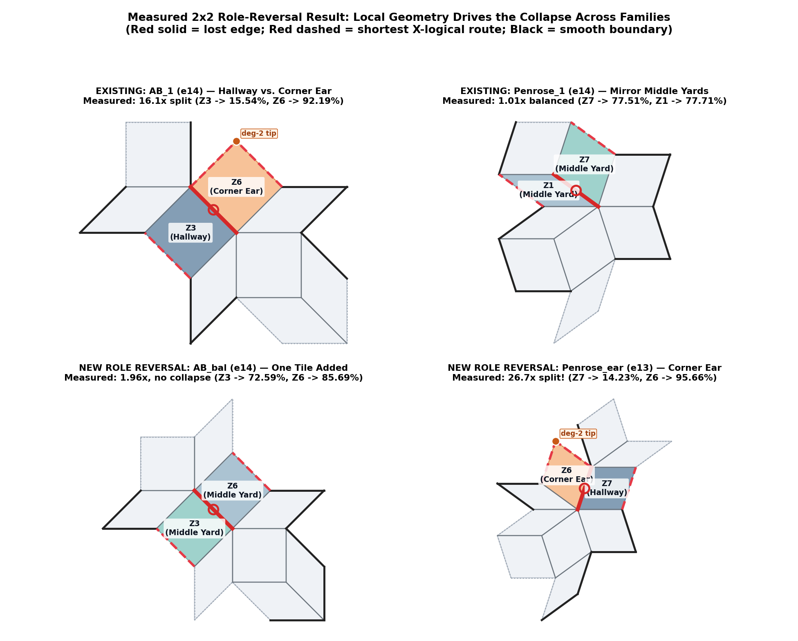

# 2×2 Role-Reversal Check: Local Bottleneck vs. Corner Ear

## Question and Pre-Score Prediction

In `exploratory/local_witness_omission_2026-11-20/`, `AB_1 (e14)` showed a **16.14×** face-omission split (`Z3` surviving gain **15.54%** vs. `Z6` **92.19%**), whereas `Penrose_1 (e14)` (**77.51%** vs. **77.71%**) and `Penrose_2 (e4)` (**80.82%** vs. **81.12%**) were nearly 50/50 balanced.

Read-only geometry inspection of the entire frozen `n=21, d=(3,3)` disk-cut pool (`1,282` AB cuts / `503` on-route eligible edges; `1,791` Penrose cuts / `717` on-route eligible edges) showed that **only two** local face-pair geometries occur in either family:
1. **Mirror Middle Yards** (both faces have 1 smooth boundary edge, 3 interior edges, 3 Z-neighbors): **435/503** (86.5%) in AB, **653/717** (91.1%) in Penrose.
2. **Hallway vs. Corner Ear** (one face has 1 smooth boundary edge / 3 Z-neighbors; the other has 2 smooth boundary edges meeting at a degree-2 tip / 2 Z-neighbors): **68/503** (13.5%) in AB, **64/717** (8.9%) in Penrose.

Before running the decoder on any new site, we selected two role-reversal cuts from the frozen pool:
- **`AB_bal` (`spec=(22, 2, 2, 10)`, `corners=(2, 5, 11, 15)`, `e14`, `q9`):** literally `AB_1` (`spec=(22, 2, 2, 9)`) plus **one extra tile** filling in `Z6`'s corner ear so `Z3` and `Z6` become locally matched middle yards (both 1 smooth boundary edge, 3 Z-neighbors, corner degrees `(3, 3, 5, 5)`, unique weight-3 X-logical). **Prediction:** AB's 16:1 collapse disappears and the two face costs draw together.
- **`Penrose_ear` (`spec=(7, 1, 3, 10)`, `corners=(0, 4, 9, 13)`, `e13`, `q9`):** exact structural twin of `AB_1`, pairing a hallway face (`Z7`: 1 smooth boundary edge, 3 Z-neighbors) with a protruding degree-2 corner ear (`Z6`: 2 smooth boundary edges, 2 Z-neighbors, forked exits). **Prediction:** Penrose flips lopsided, with hallway `Z7` costing far more than corner ear `Z6`.

---

## Verdict: 2-for-2 Role Reversal

Both predictions held cleanly across all **385,648** histories per site (see [`results/table.md`](results/table.md)):

| Local shape around the loss edge | Ammann–Beenker | Penrose |
|---|---|---|
| **Two Middle Yards** *(1 bnd edge, 3 Z-nbrs each)* | **`AB_bal (e14)` [NEW]:** `Z3` keeps **72.59%** (`+0.02565 pp`) `Z6` keeps **85.69%** (`+0.01306 pp`) *(cost ratio drops 8×: `16.14×` → **`1.96×`**)* | **`Penrose_1 (e14)`:** **77.51%** vs. **77.71%** *(1.01×)* **`Penrose_2 (e4)`:** **80.82%** vs. **81.12%** *(1.02×)* |
| **Hallway vs. Corner Ear** *(deg-2 tip)* | **`AB_1 (e14)`:** `Z3` crashes to **15.54%** (`+0.08425 pp`) `Z6` keeps **92.19%** (`+0.00522 pp`) *(cost ratio **`16.14×`**)* | **`Penrose_ear (e13)` [NEW]:** `Z7` crashes to **14.23%** (`+0.08385 pp`) `Z6` keeps **95.66%** (`+0.00314 pp`) *(cost ratio **`26.67×`**)* |

### Key Takeaways & Honest Scope
1. **The catastrophic collapse follows local shape, not tiling family:** Giving Penrose a degree-2 corner ear reproduces (and sharpens) AB\_1's collapse (**26.67×**, `14.23%` vs. `95.66%`). Filling in AB\_1's corner ear with one tile eliminates the collapse (**15.54% → 72.59%** on `Z3`, ratio dropping **8×** from `16.14×` to `1.96×`).
2. **Residual ~2× asymmetry on `AB_bal`:** Even with the corner ear filled in, `AB_bal` shows a mild `1.96×` ratio (`72.59%` vs. `85.69%`) rather than `1.00×`. Thus the degree-2 corner ear drives the **order-of-magnitude (~16–27×) bottleneck collapse**, while smaller ~2× load differences can still arise from wider second-ring patch asymmetry.
3. **"Narrow Now" baseline replicates:** Intact 8-reading local recovery is **99.26%** on `AB_bal` (`0.09548 / 0.09619 pp`) and **98.83%** on `Penrose_ear` (`0.09796 / 0.09912 pp`).

---

## Validation & Replay

- **Exact engine:** Unchanged `(3,3)` decoder, `p = 0.001`, `CorrectedPatchCode` matrix-incidence check, shared-onset inference, XOR simulator, exhaustive `k <= 2` fault stream (`config_stream_sha256 = b096c5bf...`, 385,648 histories/site).
- **Full-scan check:** Deterministic sample (every 2,003rd history) ran **1,344** unaccelerated full-scan comparisons per site with **0 mismatches** and `max_posterior_difference = 0.0`.
- **No sealed files modified:** All existing experiment directories remain untouched.
- **Replay:** `python3 exploratory/role_reversal_omission_2026-11-22/run_role_reversal.py`
