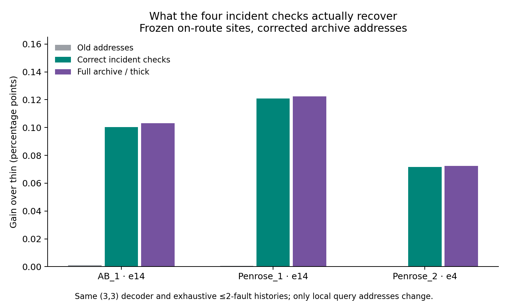
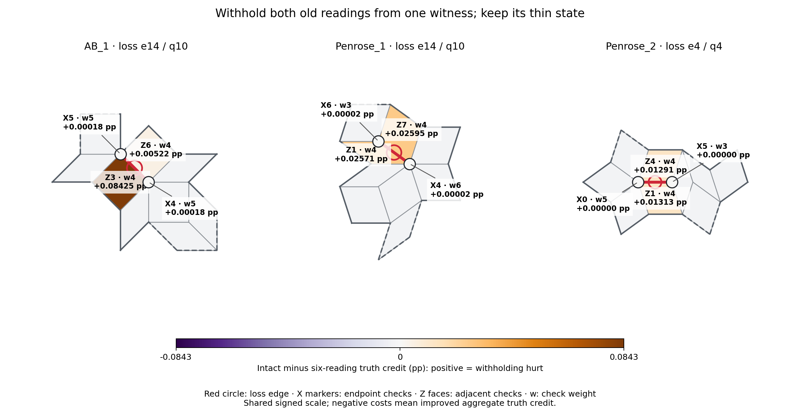
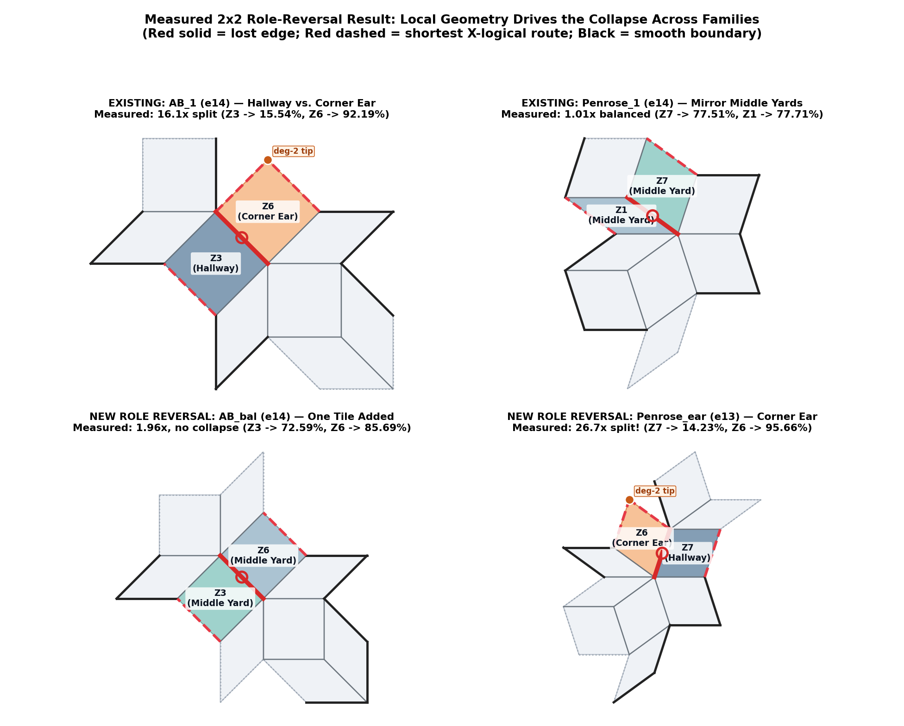

# Which Old Readings Matter? Local Geometry, Load-Bearing Faces, and Zero-Net-Cost Steering in Aperiodic Surface Codes

**K. T. Niedzwiecki**  
Independent Researcher, South Australia  
22 November 2026 *(Draft v0.1 — working manuscript)*

---

## Abstract

When a data qubit is lost on a surface-code patch, a decoder with access to past stabilizer readings outperforms a memoryless ("thin") decoder — especially when the lost edge sits on a shortest logical route. Here we ask a sharper follow-up question: **which specific archived readings actually carry that decoding advantage, and what determines how the load is shared?** Using exhaustive zero-, one-, and two-fault evaluation (385,648 histories per site; bounded `(3,3)` decoder, $p = 0.001$) across five `n=21`, distance-`(3,3)` Ammann–Beenker (AB) and Penrose patches, we find four results:

- **The "Narrow Now" holds across both tilings.** Once an indexing bug in the original adapter is corrected (11-check address audit), keeping just **eight** archived readings — two early rounds from the four stabilizer checks incident to the lost edge — recovers **97.25–99.26%** of the full-archive accuracy gain across all five tested sites.
- **Hidden load-bearing faces.** Withholding just two archived readings from a single adjacent Z-face reveals a striking split on `AB_1 (e14)`: omitting face `Z3` collapses surviving gain to **15.54%** (`+0.08425 pp` cost), whereas omitting its partner `Z6` retains **92.19%** (`+0.00522 pp` cost) — a **16.14×** cost ratio between two weight-4 Z-checks sharing the same lost edge. By contrast, `Penrose_1 (e14)` (**77.51%** vs. **77.71%**) and `Penrose_2 (e4)` (**80.82%** vs. **81.12%**) share the load nearly 50/50.
- **Local geometry — not tiling family — drives the collapse (2×2 role reversal).** A complete census of all 1,220 on-route eligible edges in the frozen `n=21, d=(3,3)` AB and Penrose pools shows that **only two** local face-pair geometries occur in either family: *Mirror Middle Yards* (both faces have 1 smooth boundary edge and 3 neighboring Z-faces; 86.5% in AB, 91.1% in Penrose) and *Hallway vs. Corner Ear* (one middle-yard bridge paired with a protruding 2-boundary-edge ear terminating in a degree-2 corner vertex; 13.5% in AB, 8.9% in Penrose). In a pre-registered 2×2 role reversal:
  1. Adding **one extra tile** to `AB_1` (`AB_bal`) fills in `Z6`'s corner ear, lifting `Z3`'s surviving gain from **15.54% → 72.59%** and cutting the face cost ratio by more than 8× (**16.14× → 1.96×**).
  2. Selecting a Penrose cut with a degree-2 corner ear (`Penrose_ear`) reproduces and sharpens the collapse: omitting hallway `Z7` crashes surviving gain to **14.23%**, while omitting corner ear `Z6` retains **95.66%** (**26.67×** cost ratio).
- **Zero-net-cost decision steering.** On `Penrose_2 (e4)`, withholding endpoint X-check `X5` produces **0.00000000 pp** net accuracy change while flipping **44 individual decoding decisions** (credit lost exactly equals credit gained). A flat aggregate score does not mean a witness is inert.

---

## 1. Introduction

A fault-tolerant decoder with a finite memory budget faces a concrete version of a broader question: *what from the past must be kept so that the present can still decide accurately?* In a recent prospective study on fresh aperiodic surface-code patches (`AB_1`, `Penrose_1`, `Penrose_2`), we confirmed that full-archive memory helps most when a lost edge lies on a shortest X-logical route — producing a 22–40× brighter archive advantage on-route than at matched off-route edges.

At first glance, that study appeared to carry a puzzling second result: keeping only the eight local archived readings touching the lost edge (the "diamond" bracket) seemed to recover almost none of the on-route advantage. An independent address audit revealed why: on `11×9` (`HX`×`HZ`) patches, the legacy adapter had mapped Z-check indices assuming 10 X-rows, silently querying the wrong checks. Once the address map was fixed, the picture flipped completely: **97.25–98.97%** of the full-archive benefit lived right inside the four checks touching the lost edge.

That sharp localization opened an immediate, surgical follow-up: if nearly the entire memory advantage lives inside four local checks (two incident Z-faces and two endpoint X-checks), **do those four witnesses share the load equally, or does the local patch geometry concentrate the burden on one of them?**

---

## 2. Experimental Setup and Pre-Registered Lineage

All experiments share the same pinned geometry generator, XOR syndrome simulator, shared-onset erasure inference, and bounded `(3,3)` decoder (`w_dec = 3`, `w_frame = 3`, physical error rate $p = 0.001$), evaluated exhaustively over all zero-, one-, and two-fault ordinary configurations (48,206 configurations × 8 onset/free-value variants = **385,648 histories per site**).

- **Corrected local bracket ("intact"):** Retains rounds $t \in \{1, 2\}$ of the four checks geometrically incident to the lost edge (8 archived coordinates), plus live rounds $t \in \{3, 4\}$ of all checks and the thin-state boundary parity.
- **Single-witness omission:** Removes rounds $t \in \{1, 2\}$ of one named incident check (leaving 6 archived coordinates). Withheld coordinates are strictly **absent**, never zero-filled; live rounds and boundary parities remain untouched.
- **Primary score:** Weighted tie-aware truth credit (ties receive 0.5 credit), reported in percentage points (`pp`). Omission cost is `100 × (intact credit − omission credit)`; positive cost means withholding hurt. We also track weighted credit *lost* and *gained* separately, plus unweighted label and tie-status flips.
- **Validation:** Every site completed a deterministic unaccelerated full-scan verification sample (every 2,003rd history) with **0 mismatches** and `max_posterior_difference = 0.0`.

---

## 3. Pillar 1 — The "Narrow Now" Baseline

Across the three original fresh cuts (from `audit/fresh-site-addresses-2026-11-20`) and the two new role-reversal cuts (`experiment/role-reversal-omission-2026-11-22`), retaining only the four local witnesses touching the lost edge captures nearly the entire full-archive gain:

| Site | Tiling | Full archive gain (`thick − thin`, pp) | Intact 8-reading gain (`pp`) | Local recovery (% of full) |
|---|---|---:|---:|---:|
| `AB_1 (e14)` | Ammann–Beenker | +0.103101 | +0.100270 | **97.25%** |
| `Penrose_1 (e14)` | Penrose | +0.122290 | +0.120741 | **98.73%** |
| `Penrose_2 (e4)` | Penrose | +0.072349 | +0.071602 | **98.97%** |
| `AB_bal (e14)` *(new)* | Ammann–Beenker | +0.096195 | +0.095485 | **99.26%** |
| `Penrose_ear (e13)` *(new)* | Penrose | +0.099118 | +0.097956 | **98.83%** |

---

## 4. Pillar 2 — The Witness-Omission Stress Test

Withholding one incident check at a time across the three original sites (12 omission arms total; `experiment/local-witness-omission-2026-11-20`, commit `1922a7b`) revealed a stark asymmetry on `AB_1` alongside balanced load-sharing on both Penrose patches:

| Site | Omitted check | Role / weight | Cost (`pp`) | Surviving gain (% of full) | Label flips | Tie flips |
|---|---|---|---:|---:|---:|---:|
| `AB_1 (e14)` | `X4` / `X5` | endpoint / 5 | +0.000184 | 97.08% | 82 / 90 | 8 / 8 |
| `AB_1 (e14)` | **`Z3`** | **face / 4** | **+0.084253** | **15.54%** | **4,785** | 4 |
| `AB_1 (e14)` | `Z6` | face / 4 | +0.005219 | **92.19%** | 2,112 | 4 |
| `Penrose_1 (e14)` | `X4` / `X6` | endpoint / 6, 3 | +0.000018 | 98.72% | 570 / 572 | 12 / 12 |
| `Penrose_1 (e14)` | `Z1` | face / 4 | +0.025708 | **77.71%** | 2,152 | 4 |
| `Penrose_1 (e14)` | `Z7` | face / 4 | +0.025948 | **77.51%** | 3,468 | 12 |
| `Penrose_2 (e4)` | `X0` / `X5` | endpoint / 5, 3 | **0.000000** | 98.97% | **18 / 44** | 2 / 2 |
| `Penrose_2 (e4)` | `Z1` | face / 4 | +0.013131 | **80.82%** | 1,368 | 14 |
| `Penrose_2 (e4)` | `Z4` | face / 4 | +0.012910 | **81.12%** | 2,480 | 10 |

On `AB_1`, `Z3` and `Z6` are both weight-4 Z-checks sitting on opposite sides of the exact same lost edge `e14`, yet omitting `Z3` costs **16.14×** more than omitting `Z6`.

---

## 5. Pillar 3 — Local Bottleneck vs. Corner Ear, and the 2×2 Role-Reversal Test

### 5.1 Read-only structural diagnosis
Graph inspection of the sealed patch definitions explains the `AB_1` split geometrically:
- On **`AB_1 (e14)`**, `Z3` (`{5, 6, 7, 10}`) is an **interior bridge ("hallway")** with **1** smooth boundary edge (`q5`), **3** interior edges, **3** neighboring Z-faces (`Z0, Z2, Z6`), and corner degrees `(3, 3, 5, 5)`. Both shortest (weight-3) X-logicals through `e14` (`{5, 10, 14}` and `{5, 10, 15}`) funnel through `Z3`'s single boundary edge `q5`. By contrast, `Z6` (`{10, 11, 14, 15}`) is a **protruding corner ear** with **2** exposed smooth boundary edges (`q14, q15`) meeting at a **degree-2 corner tip** (`v12`, weight-2 X-check `X7 = {14, 15}`), only **2** interior edges, and only **2** neighboring Z-faces (`Z3, Z7`). The two shortest X-logicals fork across `q14` vs. `q15` modulo `X7`.
- On **`Penrose_1` (`Z7` vs. `Z1`)** and **`Penrose_2` (`Z1` vs. `Z4`)**, every face in both pairs is a **middle yard**: **1** smooth boundary edge, **3** interior edges, **3** neighboring Z-faces, identical sorted patch-graph corner degrees (`(3, 3, 3, 6)` and `(3, 3, 4, 5)`), and a single symmetric X-logical exit.

### 5.2 Complete census of the frozen `n=21, d=(3,3)` pool
Enumerating every on-route eligible edge in the frozen disk-cut generator shows that **only these two** local face-pair geometries occur in either tiling family:

| Family | `n=21, d=(3,3)` cuts | On-route eligible edges | Mirror Middle Yards | Hallway + Corner Ear |
|---|---:|---:|---:|---:|
| **Ammann–Beenker** | 1,282 | 503 | **435** (86.5%) | **68** (13.5%) |
| **Penrose** | 1,791 | 717 | **653** (91.1%) | **64** (8.9%) |

### 5.3 Pre-registered 2×2 role reversal
To separate local geometry from tiling family, we selected two role-reversal cuts from the frozen pool **before** running the decoder:
1. **`AB_bal` (`spec=(22, 2, 2, 10)`, `corners=(2, 5, 11, 15)`, `e14`):** `AB_1` plus **one extra tile** filling in `Z6`'s corner ear so `Z3` and `Z6` become locally matched middle yards (both 1 smooth boundary edge, 3 Z-neighbors, corner degrees `(3, 3, 5, 5)`, unique weight-3 X-logical).
2. **`Penrose_ear` (`spec=(7, 1, 3, 10)`, `corners=(0, 4, 9, 13)`, `e13`):** exact structural twin of `AB_1`, pairing hallway `Z7` (1 smooth boundary edge, 3 Z-neighbors) with corner ear `Z6` (2 smooth boundary edges meeting at a degree-2 tip, 2 Z-neighbors, forked exits).

| Local shape around the loss edge | Ammann–Beenker | Penrose |
|---|---|---|
| **Two Middle Yards** *(1 bnd edge, 3 Z-nbrs each)* | **`AB_bal (e14)` [NEW]:** `Z3` **72.59%** (`+0.02565 pp`) vs. `Z6` **85.69%** (`+0.01306 pp`) *(cost ratio drops 8×: `16.14×` → **`1.96×`**, no collapse)* | **`Penrose_1 (e14)`:** **77.51%** vs. **77.71%** *(1.01×)* **`Penrose_2 (e4)`:** **80.82%** vs. **81.12%** *(1.02×)* |
| **Hallway vs. Corner Ear** *(deg-2 tip)* | **`AB_1 (e14)`:** `Z3` **15.54%** (`+0.08425 pp`) vs. `Z6` **92.19%** (`+0.00522 pp`) *(cost ratio **`16.14×`**)* | **`Penrose_ear (e13)` [NEW]:** `Z7` **14.23%** (`+0.08385 pp`) vs. `Z6` **95.66%** (`+0.00314 pp`) *(cost ratio **`26.67×`**)* |

Both predictions held cleanly: giving Penrose a corner ear creates an even sharper **26.67×** collapse, while filling in `AB_1`'s corner ear with a single tile eliminates the collapse (`Z3` rises from **15.54% → 72.59%**, cost ratio drops **8×** to **1.96×**).

---

## 6. Pillar 4 — Zero-Net-Cost Decision Steering

Aggregate accuracy can conceal active decision-level movement. On `Penrose_2 (e4)`, withholding endpoint `X5` incurs **0.00000000 pp** net cost — weighted credit lost (`0.00020747 pp`) exactly cancels credit gained (`0.00020747 pp`) — yet **44 individual histories flip their decoded label** (plus 2 tie-status changes). Withholding `X0` similarly yields exact zero net cost while flipping **18** labels (+ 2 tie changes). On `Penrose_1 (e14)`, `X4` and `X6` incur tiny net costs (`+0.00001844 pp`) while flipping **570** and **572** decisions, respectively. On `AB_bal (e14)`, by contrast, `X2` and `X3` show true invariance (`0.00000000 pp` cost, **0** label flips). Thus zero net cost is not synonymous with zero causal influence on individual decoding trajectories.

---

## 7. Guardrails, Caveats, and Scope

1. **Z-check vs. X-check caveat:** Adjacent faces are Z-checks directly measuring the syndrome of X faults that flip the scored Z logical, whereas endpoints are X-checks (entering mainly through shared-onset inference). This naturally explains why faces outweigh endpoints overall, while leaving every **face-vs.-face** comparison (`Z3` vs. `Z6`, `Z7` vs. `Z1`, `Z1` vs. `Z4`, `Z7` vs. `Z6`) strictly controlled.
2. **Local geometry, not a universal family law:** The 16–27× collapse is a local bottleneck-vs.-corner-ear effect shared by both tilings, not an intrinsic AB-vs.-Penrose separation. Moreover, follow-up inspection of `AB_bal` shows that `Z3` and `Z6` are exact local mirror twins through both the first and second neighbor rings (identical `(w4 smooth, w2 rough, w4 smooth)` first-ring neighbors, identical `(3, 3, 5, 5)` corner degrees, and identical 4-vs.-4 overlap with weight-4 X-logicals through `q9`). Its mild residual **1.96×** ratio (`72.59%` vs. `85.69%`) instead reflects global patch asymmetry and the placement of the fixed `scored_logical_Z` representative (`[3, 1, 0]`), which threads `Z3`'s boundary edge (`q3`) and immediate neighbor `Z0` (`q0, q1`) while having zero overlap with `Z6` or `Z7`. Thus first-ring corner-ear geometry drives the order-of-magnitude (~16–27×) collapse, while global/observable placement can still produce a ~2× tilt.
3. **Scope and strict separation:** Results are established for bounded `(3,3)` decoding, exhaustive `k <= 2` ordinary faults at $p = 0.001$, across five `n=21, d=(3,3)` cuts. This manuscript stands solely on these verified QEC decoder artifacts and is kept strictly separate from the algebraic unit-norm conjugacy work (`norm_identity_check.py` / the unwritten July skeleton).

---

## 8. Provenance and Reproducibility

| Component | Branch / Commit | Key Paths |
|---|---|---|
| Prospective route prediction & patch JSONs | `claude/aperiodic-predict-2026-11-20` (`fdeaa32`) | `exploratory/aperiodic_predict_2026-11-20/HANDBACK.md`, `results/{AB_1,Penrose_1,Penrose_2}.json` |
| 11-check address audit ("Narrow Now") | `audit/fresh-site-addresses-2026-11-20` | `exploratory/fresh_site_address_audit_2026-11-20/HANDBACK.md`, `results/table.md`, `results/corrected_recovery.png` |
| 12-arm witness-omission stress test | `experiment/local-witness-omission-2026-11-20` (`1922a7b`) | `exploratory/local_witness_omission_2026-11-20/HANDBACK.md`, `results/table.md`, `results/omission_costs.png` |
| 2×2 role-reversal test (`AB_bal`, `Penrose_ear`) | `experiment/role-reversal-omission-2026-11-22` (`6236920`) | `exploratory/role_reversal_omission_2026-11-22/HANDBACK.md`, `results/table.md`, `results/role_reversal_2x2.png`, `run_role_reversal.py` |

---

## Acknowledgements

*[Placeholder — to be written in K. T. Niedzwiecki's own voice before final submission.]*
